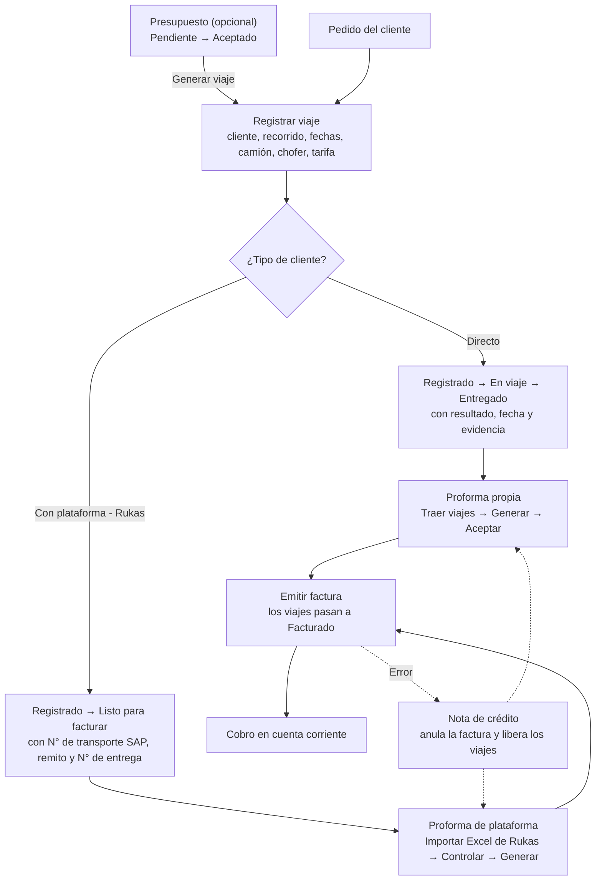
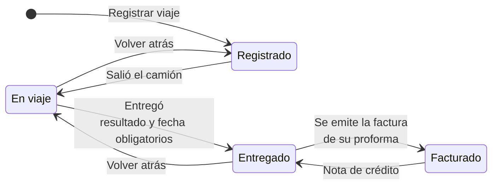
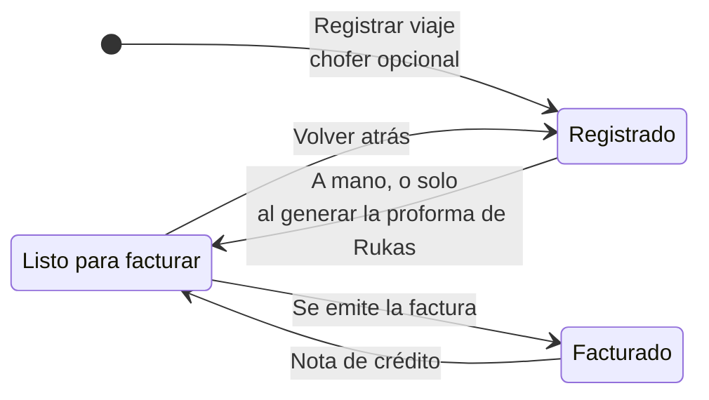
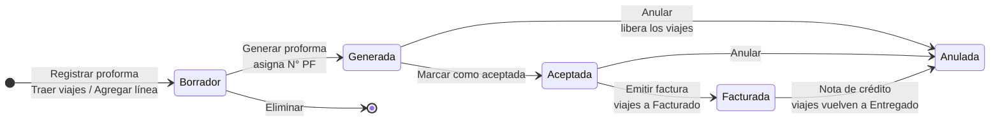
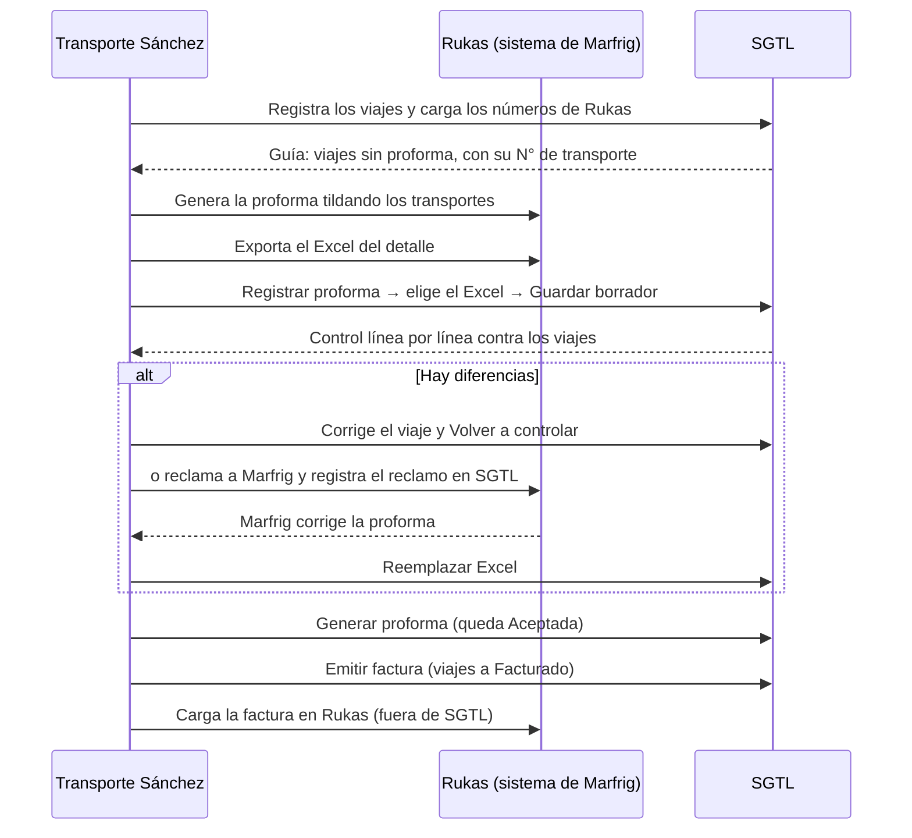
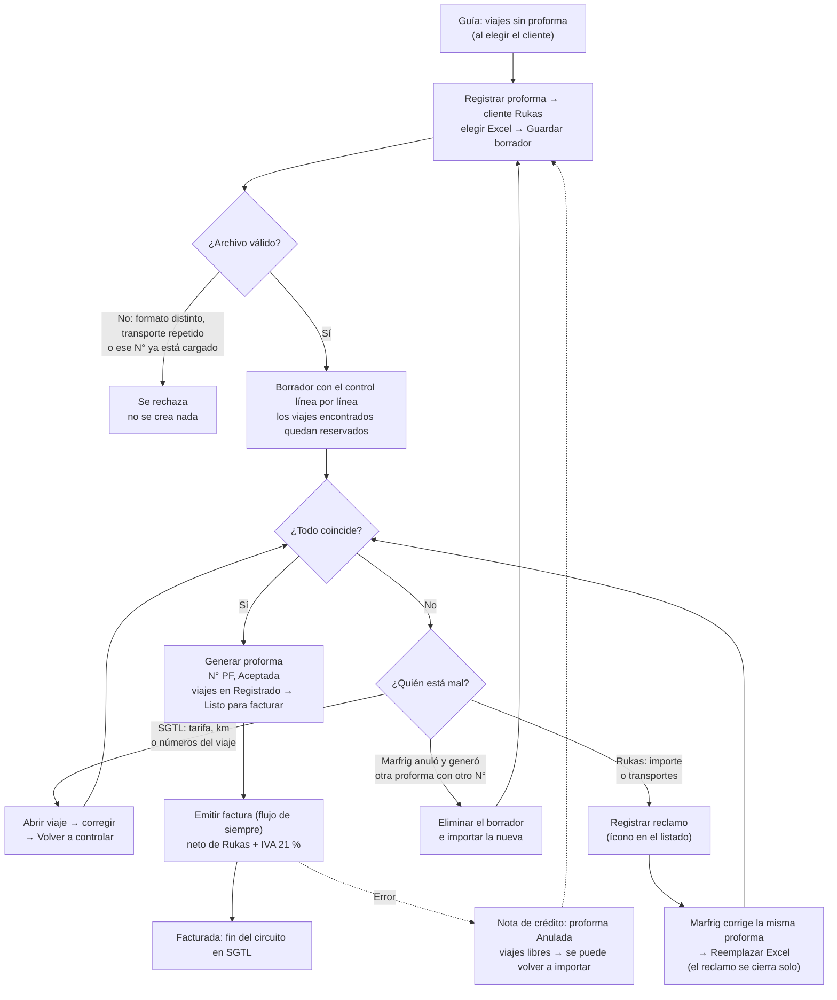
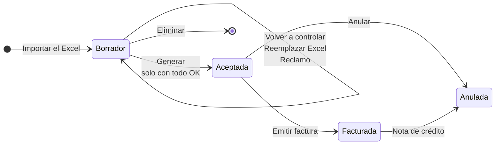
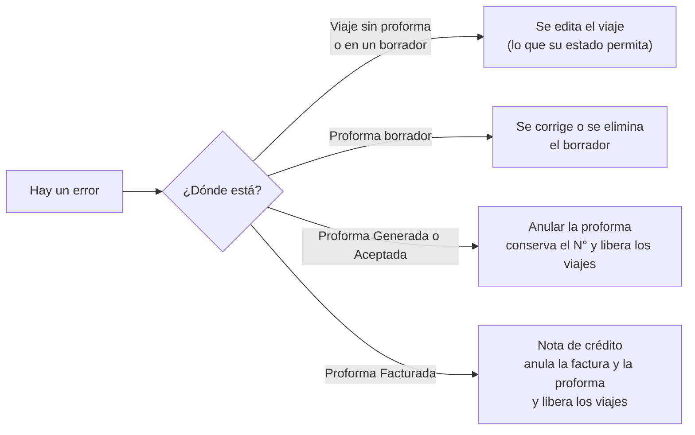

# Flujos de viajes y proformas — diagramas

Cómo funciona hoy SGTL desde que se pide un viaje hasta que se factura, con todas las variantes.
Sirve para la presentación de la tesis y para que el equipo entienda qué está probando.
El paso a paso para probar cada flujo en pantalla está en `docs/equipo/INSTRUCTIVO-PRUEBAS-VIAJES-Y-PROFORMAS.md`.

Los diagramas están en Mermaid: se ven dibujados en GitHub y en Visual Studio Code (con la vista previa de Markdown).

**Actualizado al 19/10/2026** (rama `rocionuvoli`, igual a `main`).

### Cómo leer los diagramas

Hay tres tipos de diagrama. Cada uno tiene sus propias referencias.

**Diagramas de flujo** (§1, §4.2 y §5): cómo se avanza de un paso al siguiente.

| Símbolo | Significa |
|---|---|
| Rectángulo | Un paso o una acción en SGTL ("Registrar viaje", "Generar proforma") |
| Rombo | Una decisión o una pregunta ("¿Tipo de cliente?", "¿Todo coincide?"). Cada flecha que sale tiene la respuesta |
| Flecha llena | El camino normal |
| Flecha punteada | Un camino que solo se toma **si hay un error**: la corrección (por ejemplo, anular la factura con nota de crédito) |
| Texto sobre una flecha | La condición o el botón que lleva al paso siguiente |

**Diagramas de estados** (§2.1, §2.2, §3 y §4.4): en qué estados puede estar un viaje o una proforma y cómo pasa de uno a otro.

| Símbolo | Significa |
|---|---|
| Caja redondeada | Un estado ("Registrado", "Aceptada") |
| Punto negro | El comienzo (la flecha que sale es cómo se crea) o el final (por ejemplo, un borrador eliminado deja de existir) |
| Flecha | Un cambio de estado posible. El texto dice qué lo provoca: un botón ("Generar"), algo que hace el sistema solo ("Se emite la factura") o una corrección ("Nota de crédito") |
| Flechas de ida y vuelta | Se puede avanzar y también volver un paso atrás |

**Diagrama de secuencia** (§4.1): quién hace qué, en orden, entre Transporte Sánchez, Rukas y SGTL.

| Símbolo | Significa |
|---|---|
| Columna | Un participante (la persona de Transporte Sánchez, el sistema Rukas o SGTL) |
| Flecha llena | Una acción de un participante sobre otro, de arriba hacia abajo en el orden en que pasan |
| Flecha punteada | Lo que el otro devuelve o responde (por ejemplo, el control que muestra SGTL). Acá **no** significa error |
| Recuadro "alt" | Pasos que solo ocurren en ese caso ("Hay diferencias") |

---

## 1. Mapa general

Hay dos tipos de cliente, y cada uno sigue un camino distinto hasta la factura:

- **Directo:** SGTL es el único registro del viaje. Se sigue de punta a punta (salida, entrega, evidencia) y se factura con una **proforma propia**.
- **Con plataforma (Rukas):** el cliente (Marfrig / Quickfood) opera los viajes en su sistema, Rukas. En SGTL queda el viaje con los números de Rukas, y se factura con una **proforma de plataforma**, que se arma importando el Excel que se exporta de Rukas y se controla línea por línea contra los viajes de SGTL.

**Sobre la factura:** SGTL no está conectado a ARCA, así que la **factura interna de SGTL cumple el rol de la factura fiscal**. Para los clientes con plataforma, es la que se carga en Rukas. Cuando se integre ARCA, esa misma factura pasa a ser la fiscal (con CAE) y el circuito no cambia.

---

## 2. Estados del viaje

### 2.1 Cliente directo

- Se avanza o se vuelve **de a un paso**, con el botón "Estado y entrega" de la fila.
- **Entregado** pide el resultado (Completa, Parcial o Rechazo) y la fecha de entrega. La **evidencia** (foto o PDF del remito firmado, o con la nota del cliente si hubo rechazo) es obligatoria desde el 22/10, con cualquier resultado; se adjunta en la misma ventana.
- **Facturado** no se elige a mano: lo pone la factura y lo saca la nota de crédito.
- Solo los viajes **Entregados** entran en una proforma propia ("Traer viajes").

### 2.2 Cliente con plataforma (Rukas)

- El seguimiento fino (salida, novedad, sobre, conformidad) se hace en Rukas. En SGTL no hace falta reflejarlo.
- Los tres números de Rukas se cargan **a medida que aparecen**: el **N° de transporte SAP** y el **remito** cuando el camión carga en planta, y el **N° de entrega** cuando hay novedad de entrega. Se pueden completar en cualquier estado.
- Para pasar a **Listo para facturar** el viaje tiene que tener los tres números y tarifa.
- No hace falta pasarlo a mano: si está en una proforma de Rukas que se genera, pasa solo.

### 2.3 Qué se puede hacer con un viaje según dónde está

| Situación del viaje | Editar | Cambiar estado | Cancelar | Eliminar |
|---|---|---|---|---|
| **Registrado**, sin proforma | Todo. Si cambian chofer, origen, destino o fecha: WhatsApp (y al anterior si cambió el chofer) | Sí | Sí, desde Cambiar estado y con motivo: queda Cancelado y se le avisa al chofer por WhatsApp | Sí, salvo que venga de un presupuesto aceptado o tenga gastos del chofer |
| **Cancelado** | No | Solo volver a Registrado (reactivarlo): se le reenvía la hoja de ruta al chofer | — | No |
| **Ya salió** (En viaje, Entregado, Listo para facturar) | Solo los números (remito, transporte SAP, entrega) | Sí | No | No |
| **Rukas en Listo para facturar**, sin proforma o en un borrador | Además, la **tarifa y los km**, para que coincida con Rukas | Sí | No | No |
| En una proforma **borrador** | Igual que según su estado | Sí | No | No |
| En una proforma **Generada o Aceptada** | No: para corregir, se anula la proforma | No | No | No |
| **Facturado** | No: para corregir, nota de crédito | No | No | No |
| **Generado desde un presupuesto aceptado** | Cliente, recorrido, km y tarifa quedan fijos (son los del presupuesto) | Sí | Sí si sigue Registrado | No |

**WhatsApp al chofer:** al registrar con chofer; al reenviar desde la grilla; al cambiar recorrido/fecha; al cambiar chofer (desasignado al anterior + asignado al nuevo); al cancelar o eliminar en Registrado (plantilla de cancelado); al reactivar un cancelado (la hoja de ruta de nuevo). Si la integración no está configurada, el viaje se guarda igual y avisa.

**Tarifa:** fija (la de la ruta: cliente + origen + destino) o por km (según el período y la distancia, que se calcula con el mapa; a mano solo si falla Google). Con presupuesto aceptado, manda el importe del presupuesto.

---

## 3. Proforma propia (clientes directos)

- **Traer viajes** trae los viajes Entregados del cliente y del período, con tarifa y que no estén en otra proforma. Avisa cuáles no trajo y por qué.
- Un viaje está en **una sola proforma** a la vez, también en borrador.
- Un **borrador** se edita y se elimina; una proforma **Generada o Aceptada** se **anula** (conserva su número); una **Facturada** se corrige con **nota de crédito**.
- Para un cliente con plataforma no se puede armar una proforma propia: el modal pide el Excel de Rukas.

---

## 4. Proforma de plataforma (Rukas)

### 4.1 Quién hace qué

### 4.2 Flujo completo con decisiones

### 4.3 Resultados del control, línea por línea

| Resultado | Qué pasa | Qué se hace | ¿Deja generar? |
|---|---|---|---|
| **Coincide** | Mismo transporte y mismo importe del viaje (al peso) | Nada | Sí |
| **Importe distinto** | Rukas y SGTL dan importes distintos. La pantalla muestra los dos y la tarifa que usó SGTL | Si SGTL está mal, corregir la tarifa del viaje y Volver a controlar; si Rukas está mal, Registrar reclamo y, con la corrección, Reemplazar Excel | No |
| **Sin viaje** | SGTL no encuentra un viaje del cliente con ese N° de transporte (no existe o está mal cargado) | Cargar o corregir el viaje y Volver a controlar | No |
| **Faltan números** | El viaje existe pero le falta el remito o el N° de entrega | Completarlo y Volver a controlar | No |
| **Sin tarifa** | El viaje no tiene tarifa o da $0 | Asignarle tarifa y Volver a controlar | No |
| **Ya facturado / En otra proforma** | Posible cobro doble | Revisar | No |
| **Viaje cancelado** | El viaje está cancelado en SGTL (no se hizo) pero Rukas lo trae | Si se hizo, volverlo a Registrado y Volver a controlar; si no, Registrar reclamo | No |
| **Repetido en SGTL** | Dos viajes con el mismo N° de transporte | Corregir el que esté mal | No |
| *Viajes fuera de la tanda* | Hay viajes del cliente con los números cargados que no están en ninguna proforma | Nada: van en la próxima. Se ven en la guía antes de tildar en Rukas; el control no los avisa (22/10) | Sí |

- Los **adicionales** de Rukas no se comparan: se toman como vienen y se suman a la proforma.
- El **reclamo** no es un estado: es una marca en el borrador (fecha y motivo) con un ícono en el listado. Se cierra a mano o solo, al reemplazar el Excel o generar.
- En un borrador se pueden editar las **condiciones comerciales** (forma y plazo de pago, etc.), como en la proforma propia. El cliente y los conceptos salen del Excel.

### 4.4 Estados de la proforma de Rukas

No pasa por "Generada": Marfrig ya la aceptó en Rukas, así que "Generar" la deja **Aceptada** directamente.

---

## 5. Cómo se corrige un error, según dónde está

En los tres últimos casos los viajes quedan libres para otra proforma. Si estaban Facturados, vuelven a Entregado (directos) o a Listo para facturar (Rukas).
