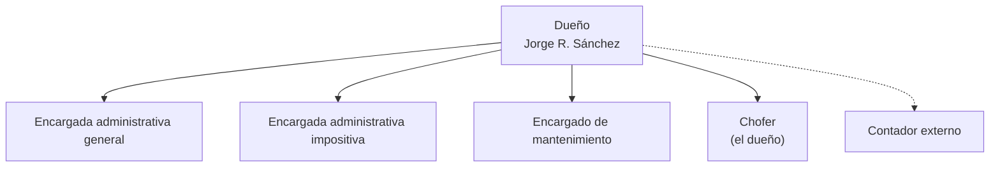
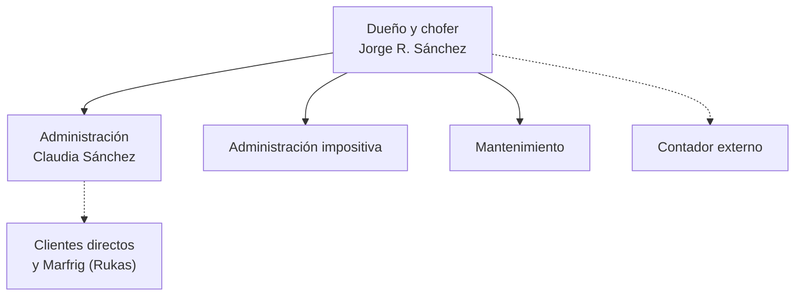
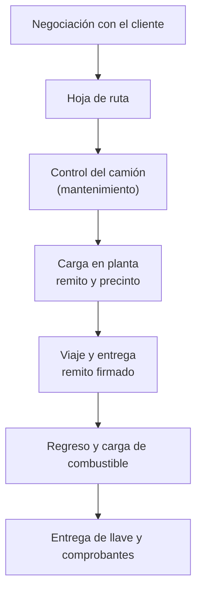
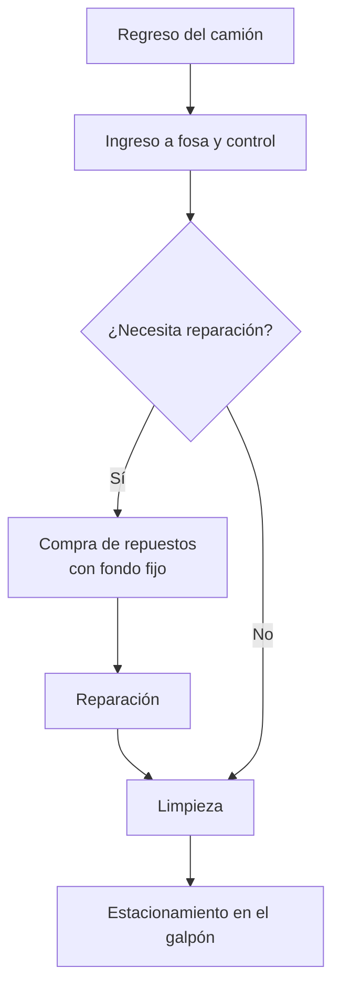
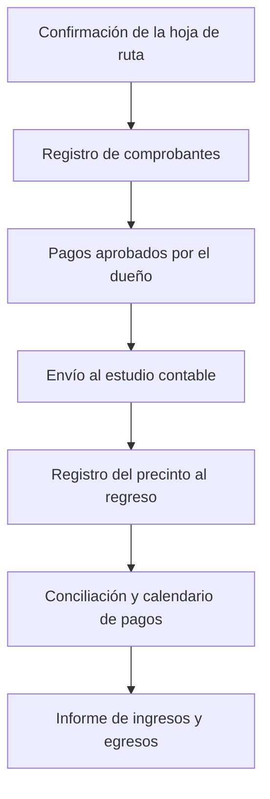
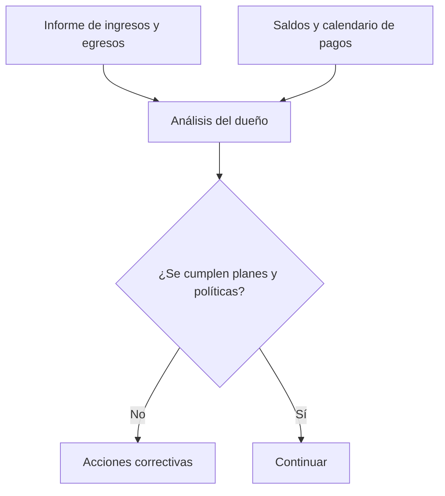
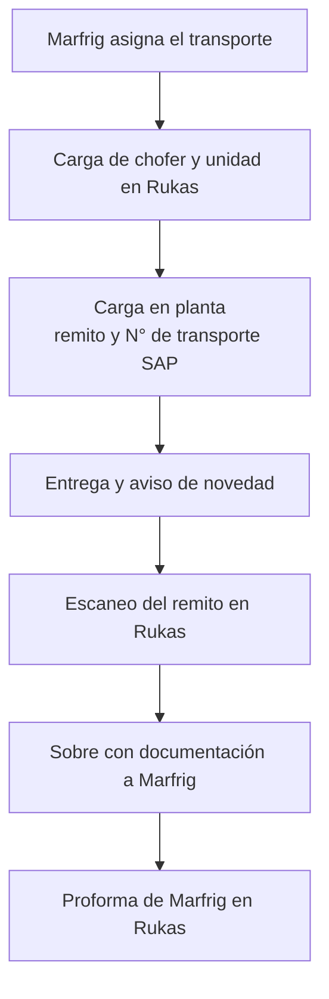
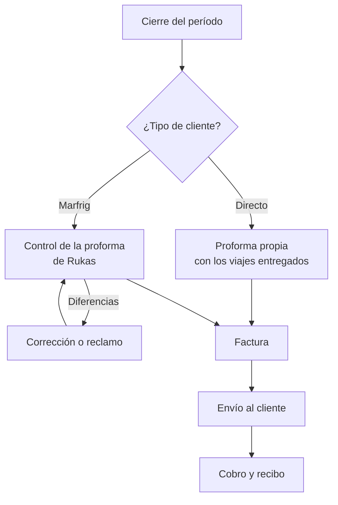

# Parte 1 — Historial, introducción y análisis organizacional

> Borrador del 20/10/2026. Texto de la V1.5 (24/06/2024) actualizado con el relevamiento de 2026.
> Los organigramas y los procesos se pasaron a diagramas.

## Historial de revisión

| Versión | Fecha | Autor | Detalle de la modificación |
|---|---|---|---|
| 1.0 – 1.2 | 21/06/2022 | Equipo | Primeros borradores del análisis organizacional (Sistemas I y II). |
| 1.3 – 1.4 | jul–nov 2022 | Equipo | Análisis organizacional completo y anteproyecto. |
| 1.5 | 24/06/2024 | Equipo | Revisión del análisis organizacional y del anteproyecto (Práctica Profesionalizante I). |
| 2.0 | 20/10/2026 | Godoy, Montenegro, Nuvoli, Sánchez | Se incorporan: historial de revisión, problemas identificados, requerimientos actualizados, impulsos, necesidades, oportunidades, límites y alcances según el sistema construido, evolutivos, propuesta metodológica, backlog del producto, sprints 0 a 24, diagrama de actores, arquitectura (despliegue, ambiente y transición de estados), modelo de datos, prueba del sistema, plan de implementación, fuentes de información, bibliografía y anexos. |

## Introducción

En el presente trabajo se analiza la empresa Transporte Sánchez, dedicada al transporte de
alimentos refrigerados y congelados, y se documenta el desarrollo de **SGTL (Sistema de Gestión
de Transporte y Logística)**, el sistema de información construido por el equipo para gestionar
sus viajes y su circuito comercial.

El relevamiento se realizó mediante entrevistas con el personal de la empresa, en particular con
Claudia Sánchez, la revisión de la documentación que la empresa intercambia con sus clientes
(remitos, hojas de ruta, proformas y facturas) y la observación del sistema Rukas, la plataforma con
la que trabaja uno de sus clientes.

En la primera parte se presenta el análisis organizacional: historia, objetivos, estructura,
políticas, recursos, procesos, controles y tecnologías. En la segunda, el anteproyecto del sistema,
con sus alcances y límites. La tercera documenta el desarrollo con Scrum: el Sprint 0, el Backlog
del Producto y los sprints realizados entre 2023 y 2026. Por último se presentan la arquitectura del
sistema, la prueba del sistema y el plan de implementación en Transporte Sánchez.

## Sistema objeto

Transporte Sánchez, ubicado en la calle Paraguay 539 de la ciudad de Las Varillas, provincia de
Córdoba.

[IMAGEN: ubicación geográfica en Google Maps — tomar de la V1.5]

## Historia y evolución de la organización

La historia de esta empresa comienza informalmente desde la temprana edad de Jorge Roberto Sánchez,
quien trabajaba ayudando en las tareas de transporte de la carnicería de su padre, Oscar Sánchez.

El proveedor de Oscar era la empresa QuickFood, donde Jorge, entre sus viajes, comenzó a hacer los
primeros contactos de forma independiente. Posteriormente, y con la ayuda económica de su padre,
Jorge adquirió su primer camión y se registró como empresa y proveedor de transporte directo de
QuickFood. A medida que fue ganando trayectoria como proveedor de esa compañía se le asignaron más
viajes, por lo que decidió comprar dos camiones más y contratar personal. Sin embargo, las
recesiones económicas que sufrió el país perjudicaron a la empresa, y Jorge decidió vender esos
camiones y volver a trabajar con una sola unidad, de la que él mismo es el chofer.

En los últimos años Transporte Sánchez dejó de depender de un único cliente. Hoy la mayor parte de
sus viajes son para clientes directos, que le piden el servicio sin intermediarios, y una parte
menor corresponde a Marfrig (dueña de la marca QuickFood), con quien trabaja a través de Rukas, la
plataforma con la que Marfrig gestiona a sus transportistas. La empresa mantiene una sola unidad y
el mismo personal.

## Actividades desarrolladas

Transporte Sánchez realiza traslados de alimentos refrigerados y congelados, en su mayoría para
clientes directos y en menor medida para Marfrig/QuickFood a través de la plataforma Rukas.
Complementa el servicio con presupuestos a pedido para viajes eventuales, la facturación mensual
por proforma y la gestión de las cobranzas.

## Objetivos planteados

El objetivo de Transporte Sánchez es el traslado en tiempo y forma de la mercadería de sus clientes,
manteniendo la cadena de frío, siendo el fin principal obtener lucro por el servicio brindado.

**Metas a corto plazo**

- Continuar con el mismo flujo de servicio.
- Mantener su posicionamiento como proveedor de transporte de sus clientes.

**Metas a mediano plazo**

- Agrandar la flota de camiones para el traslado de alimentos congelados.

**Metas a largo plazo**

- Expandirse hacia otras provincias del país.

## Organigrama formal

La empresa tiene un esquema de organización verticalista. Jorge, como dueño, toma las decisiones
estratégicas y a la vez ocupa la posición operativa, ya que él mismo realiza los viajes. En el área
administrativa se encuentran Luciana y Melina: Luciana se encarga del control de las órdenes de
trabajo, la facturación al cliente y las tareas administrativas generales, y Melina de los controles
de las cuentas bancarias y de los pagos impositivos.

## Organigrama real

En la práctica, Claudia Sánchez cubre las tareas administrativas: carga de los viajes, coordinación
con los clientes y con Rukas, presupuestos, proformas y facturación. El dueño concentra la dirección
y el manejo de la unidad.

## Departamentalización existente

La departamentalización es funcional, con los siguientes sectores:

- Dirección.
- Administración general.
- Administración impositiva.
- Operaciones (chofer).
- Mantenimiento.

### Funciones de cada departamento

**Jefe (dueño)**

- Pacta con los clientes los viajes a efectuar y sus destinos.
- Dirige, coordina, organiza y administra los recursos de la empresa.
- Según lo informado por las encargadas administrativas, confirma o rechaza la liberación de los
  pagos.
- Contrata anualmente a un contador para el soporte contable e impositivo y la liquidación de
  sueldos.
- Analiza mensualmente los informes de ingresos y egresos para la toma de decisiones estratégicas.
- Analiza semestralmente el informe de mantenimiento de la unidad (por ejemplo, si conviene invertir
  en repuestos o cambiar el camión).

**Chofer**

- Recibe las hojas de ruta de los viajes pactados.
- Transporta los productos desde la planta del cliente hasta los centros de venta y distribución.
- Registra el número de precinto con el que el cliente cierra el camión.
- Informa a la administración la hoja de ruta realizada, los kilómetros recorridos y el número de
  precinto, y entrega el remito firmado en destino.
- Notifica al encargado de mantenimiento el estado del vehículo y cualquier incidente.
- Rinde las facturas y comprobantes de los gastos del viaje.

**Encargada administrativa general**

- Recibe las hojas de ruta y los pedidos de los clientes; para Marfrig, carga en Rukas el chofer y la
  unidad de cada transporte.
- Analiza las hojas de ruta para planificar los recursos del viaje (combustible, hospedaje, peajes,
  controles sanitarios).
- Soluciona los inconvenientes que surjan durante el servicio.
- Recibe, registra, ordena y archiva los comprobantes de pago (servicios, SENASA, etc.).
- Comunica a la encargada impositiva los gastos a pagar y los montos a cobrar.
- Arma los presupuestos y las proformas, controla la proforma de Marfrig y emite las facturas.
- Controla y archiva las pólizas de seguro del vehículo y del chofer, y envía la documentación del
  camión y del chofer a los clientes, a los organismos y a SENASA.
- Registra en planillas los gastos rendidos y los movimientos de cuenta para los informes
  mensuales.

**Encargada administrativa impositiva**

- Controla diariamente las cuentas bancarias y gestiona los trámites bancarios.
- Arma el calendario de pagos (proveedores, impuestos y servicios) y lo presenta al dueño.
- Realiza las transferencias y los pagos electrónicos.
- Concilia mensualmente los movimientos de las cuentas, incluidas las tarjetas.
- Recibe la caja chica, repone los fondos y envía los comprobantes al estudio contable.

**Encargado de mantenimiento**

- Hace el chequeo general del camión al regreso de cada viaje, con énfasis en el equipo de frío.
- Lava el camión y hace las tareas de mantenimiento de menor complejidad.
- Cada 10.000 km lleva el camión al cambio de aceite y filtros; cada 50.000 km, al taller de
  refrigeración (Villa María) y al cambio de cubiertas.
- Anualmente lleva el camión a la verificación técnica vehicular (ITV).
- Rinde los comprobantes de gastos y el fondo fijo a la administración.

## Políticas organizacionales

- El chofer no está habilitado a sacar el camión del galpón sin la confirmación previa del estado por
  parte del encargado de mantenimiento.
- Garantizar el buen estado de los vehículos con revisiones internas, además de las revisiones
  externas obligatorias.
- Los viajes no se concretan sin la hoja de ruta previa.
- Si no se puede entregar la mercadería o pierde la cadena de frío, se descarta donde indique el
  cliente, una vez reportado el incidente.
- Proporcionar condiciones de trabajo seguras y saludables.
- Velar por la seguridad vial de todas las partes que intervienen en el servicio.

## Estrategias

- Brindar accesibilidad al cliente ante viajes eventuales o no previstos para fidelizarlo.
- Aprovechar los descuentos bancarios por medio de pago para reducir costos.
- Adquirir vehículos idóneos para las necesidades presentes y futuras de los clientes, con
  tecnologías más respetuosas con el medio ambiente.
- Mantener contacto permanente con los clientes para conocer sus expectativas y su grado de
  satisfacción.

## Recursos de la organización

### Recursos humanos

- Dueño (y chofer).
- Encargada administrativa general.
- Encargada administrativa impositiva.
- Encargado de mantenimiento.

### Recursos materiales

- Camión Volkswagen 17.250 E, año 2012, dominio LWY 522, con equipo de frío.
- Hidrolavadora, compresor de aire, gato hidráulico para vehículos de carga y herramientas de uso
  general.
- Equipamiento de cafetería y de librería.
- Celulares de la flota corporativa.

### Recursos tecnológicos

Dos computadoras de escritorio (administración general e impositiva), cada una con procesador Intel
i3-10100F de 3,60 GHz, placa H410M, 8 GB de memoria DDR4, disco SSD de 240 GB y Windows 10 Pro;
impresora Epson EcoTank L4260; conexión a internet por wifi y cable; dispositivo de geolocalización
en el camión.

### Recursos edilicios

- Galpón, con mesón auxiliar para refacciones.
- Escritorios, sillas y estanterías de oficina.

[IMAGEN: plano (layout) del galpón — tomar de la V1.5]

## Funcionamiento organizacional

Al comenzar la jornada, cada área prepara su lugar de trabajo y la documentación que va a usar. Como
la mayoría de los viajes son dentro de la provincia de Córdoba, no suelen superar el día. El dueño y
chofer confirma con la administración la hoja de ruta, el encargado de mantenimiento informa el
estado del vehículo y comienza el viaje hacia la planta del cliente, donde se carga la mercadería y
se registra el precinto.

Mientras el chofer hace el viaje, la administración y mantenimiento avanzan con sus tareas
periódicas: control y archivo de documentación, coordinación de los cambios de aceite, carga de
viajes y control de proformas. Al mediodía se corta para el almuerzo y se retoma a las 17 h; por la
tarde se incorpora la encargada impositiva, que se comunica con el contador por los vencimientos.

Al regreso del chofer, la administración registra el precinto, recibe el remito firmado y los
tickets de gastos; mantenimiento recibe la llave y revisa el vehículo, y la encargada impositiva
informa al dueño los estados de cuenta y el calendario de pagos.

### Ambiente

#### Clientes

- **Clientes directos (la mayoría).** Clientes que piden el viaje por teléfono, WhatsApp o correo, sin
  plataforma intermedia. Transporte Sánchez registra todo el viaje y arma su propia proforma.
- **Clientes con plataforma (los menos).** Marfrig (marca QuickFood) planifica las cargas y opera los viajes en
  su propio sistema, **Rukas**. Transporte Sánchez carga allí el chofer y la unidad, informa la
  entrega y, al cierre del período, Marfrig genera una proforma con los transportes realizados que
  Transporte Sánchez controla y factura.

#### Competencia

Transporte Sánchez compite en el transporte de cargas refrigeradas y congeladas del centro de la
provincia de Córdoba. Su competencia se agrupa en tres tipos:

- **Transportistas chicos de la zona** (Las Varillas, San Francisco, Villa María), con una o pocas
  unidades con equipo de frío, que ofrecen el servicio a los mismos dadores de carga. Compiten por
  precio y disponibilidad.
- **Empresas medianas y grandes de logística refrigerada** de Córdoba capital y de Rosario, con
  flota propia, depósitos de frío y sistemas de seguimiento. Compiten por capacidad y por servicios
  agregados.
- **La flota propia o contratada directamente por los grandes dadores de carga**, como Marfrig, que
  gestionan a sus transportistas desde su propia plataforma.

Frente a ellos, la ventaja de Transporte Sánchez es la atención directa y la flexibilidad ante
viajes eventuales (ver Estrategias). Su desventaja es la escala: una sola unidad. Por eso es clave
llevar un control ordenado de los viajes, la facturación y los cobros.

*(No se encontraron fuentes públicas con nombres de competidores de la zona. Si la empresa
identifica algunos, conviene nombrar dos o tres.)*

## Procesos de la organización

A continuación se describen los procesos relevados. Los cuatro primeros son los del relevamiento de
2022; los dos últimos se relevaron en 2026, con el sistema ya en desarrollo.

### Proceso de servicio de transporte

**Evento:** negociación del dueño con el cliente.
**Objetivo:** iniciar la actividad económica, generando un lucro y fidelizando al cliente.
**Actividades:** el dueño acuerda con el cliente los destinos; con ellos se generan las hojas de
ruta. El viaje comienza en el galpón, sigue a la planta del cliente donde se retira la mercadería y
se recibe el remito con el número de precinto; durante el viaje se efectúan gastos que luego se
rinden. En destino se descarga, el chofer regresa cargando combustible y entrega la llave a
mantenimiento y los comprobantes a la administración.
**Participantes:** dueño y chofer, cliente, administración, mantenimiento.

### Proceso de mantenimiento

**Evento:** regreso de la unidad.
**Objetivo:** mantener el vehículo en condiciones para efectuar los traslados.
**Actividades:** el camión ingresa a la fosa; se controlan fluidos, tren delantero, frenos,
cubiertas y kilometraje, que se anota en una planilla. Si hace falta una reparación se compran los
repuestos con el fondo fijo y se rinden los comprobantes. Por último se limpia la unidad y se
estaciona en el galpón.
**Participantes:** encargado de mantenimiento, administración.

### Proceso administrativo

**Evento:** inicio de la jornada.
**Objetivo:** registrar los comprobantes y mantener al día los pagos y los informes.
**Actividades:** la administración confirma la hoja de ruta y da el visto bueno para el viaje;
registra en planillas los comprobantes de ingresos y egresos, concreta los pagos aprobados por el
dueño y envía los comprobantes al estudio contable. Al regreso del chofer registra el precinto;
presenta el calendario de pagos, concilia las cuentas y, al cierre, elabora el informe de ingresos y
egresos.
**Participantes:** administración general e impositiva, dueño, estudio contable.

### Proceso gerencial

**Evento:** regreso del dueño al finalizar el viaje.
**Objetivo:** controlar los resultados y tomar decisiones.
**Actividades:** el dueño revisa con la administración general el informe de ingresos y egresos y
con la impositiva los saldos bancarios y el calendario de pagos. Mensualmente verifica que se cumplan
los planes y las políticas y comunica las acciones correctivas de forma oral.
**Participantes:** dueño, administración.

### Proceso de coordinación del viaje con el cliente con plataforma

**Evento:** Marfrig asigna un transporte a Transporte Sánchez.
**Objetivo:** cumplir el viaje y dejar en la plataforma del cliente la información que exige para
pagarlo.
**Actividades:**

- Marfrig planifica la carga y avisa por correo los "transportes planeados".
- La administración ingresa a Rukas y carga el chofer y la unidad del viaje.
- El camión ingresa a planta, carga, recibe el remito en papel y sale; Marfrig registra el ingreso y
  la salida, y Rukas asigna el número de transporte SAP.
- El chofer entrega en destino y hace firmar el remito; avisa la entrega por WhatsApp a la mesa de
  Control Tráfico o la mesa la registra.
- La administración adjunta en Rukas el escaneo del remito firmado y despacha el sobre con la
  documentación física a Marfrig.
- Marfrig valida tarifas y adicionales (peajes, demoras, peones).

**Participantes:** Marfrig, chofer, administración general.

### Proceso de facturación y cobro

**Evento:** cierre del período de facturación (mensual o por tanda de transportes).
**Objetivo:** facturar los viajes realizados y controlar su cobro.
**Actividades:**

- Clientes con plataforma: se tildan en Rukas los transportes del período y se genera la proforma;
  se exporta su detalle en Excel y se controla, viaje por viaje, contra los registros propios. Si
  hay diferencias se corrige el registro propio o se reclama a Marfrig, que corrige la proforma.
- Clientes directos: la administración arma la proforma con los viajes entregados del período y la
  envía al cliente para que la acepte.
- Con la proforma aceptada se emite la factura, se envía por correo y se carga, en su caso, en la
  plataforma del cliente.
- Se registra el cobro (recibo) y se imputa a las facturas pendientes; si hay un error se emite una
  nota de crédito o de débito.

**Participantes:** administración general, administración impositiva, cliente.

## Planes

**Planes estratégicos**

- Promocionarse a través de redes sociales para tener mayor presencia en el mercado.
- Enviar correos de marketing a empresas de comercialización de productos alimenticios.
- Comprar otra unidad para tener más alcance de viajes.
- Expandirse hacia otras provincias.

**Planes operativos**

- Crear redes sociales y página web.
- Usar herramientas de envío de campañas por correo para captar nuevos clientes.
- Invertir en un nuevo camión para cumplir con los viajes de los nuevos clientes.

**A corto plazo:** redes sociales y correos de marketing. **A largo plazo:** compra de un nuevo
vehículo y construcción de un nuevo galpón.

## Controles

**Controles internos**

- Control de carga de mercadería (número de precinto): constata que la carga se realizó y que el
  almacenamiento fue sellado.
- Control del estado del vehículo (mantenimiento), que garantiza poder ofrecer el servicio.
- Control de ingresos y egresos a partir de los comprobantes.
- Control diario de los movimientos bancarios contra los registros de ingresos y egresos.
- Control de la proforma del cliente con plataforma contra los viajes propios: número de transporte,
  importe, remito y número de entrega de cada viaje.
- Control de documentación de entrega: remito firmado y resultado de la entrega (completa, parcial o
  rechazo).
- Control de que un viaje no se facture dos veces ni quede sin facturar.

**Controles externos**

- Control de mercadería: el cliente coloca un precinto numerado.
- Control de documentación vigente del camión y del chofer por parte del cliente, los organismos
  gubernamentales y SENASA.

## Tecnologías

Además de SGTL, la empresa usa:

- Correo electrónico (Gmail) para la documentación con clientes y el estudio contable.
- Google Drive para guardar y compartir documentación.
- WhatsApp para la comunicación con choferes y con la mesa de Control Tráfico del cliente.
- Planillas de Excel para registros administrativos, gastos e informes.
- Rukas, plataforma web provista por el cliente Marfrig (no es propia).
- El servicio de facturación electrónica de ARCA, donde se emite la factura fiscal. SGTL todavía no
  está conectado con ARCA: su factura es interna y se integra como evolutivo.

Sigue sin tener página web ni redes sociales propias (V1.5).

## Problemas identificados

**Área administrativa**

- Los viajes se registran en varios lugares (Rukas, planillas, correo, papel) y no hay un registro
  propio y completo de todos los viajes de la empresa.
- El control de la proforma del cliente contra los viajes realizados es manual, viaje por viaje,
  y las diferencias de importe se detectan tarde o no se detectan.
- No hay un control sistemático de qué viajes ya se facturaron y cuáles no.
- La cuenta corriente de cada cliente (facturas, cobros, saldos y vencimientos) se arma a mano en
  planillas.
- Los presupuestos a clientes se arman y envían sin un registro común, y no quedan vinculados al
  viaje que finalmente se hace.

**Operaciones**

- La hoja de ruta se comunica al chofer de manera informal (mensaje o llamada) y no queda constancia
  de qué se le envió.
- La distancia de cada viaje se estima a mano, y de ella depende la tarifa por kilómetro.
- La documentación de entrega (remito firmado, resultado) no queda asociada al viaje en un sistema
  propio.

**Dirección**

- No hay indicadores consolidados (viajes por mes, facturación por cliente, costo por viaje) para
  tomar decisiones.
- Depender de la plataforma de un cliente para conocer el estado de los viajes impide atender
  clientes nuevos con el mismo nivel de control.

**En general**

- La información se comparte por correo y WhatsApp, sin acceso simultáneo ni control de quién
  cambió qué.

## Requerimientos

### Funcionales

**Administración del sistema**

- RF01. Ingresar con usuario y contraseña; cerrar sesión.
- RF02. Administrar usuarios, grupos y los permisos de cada grupo sobre los menús del sistema.
- RF03. Asignar permisos especiales de facturación y cuenta corriente (emitir y anular facturas,
  notas de crédito y débito y recibos; consultar cuenta corriente).
- RF04. Registrar automáticamente en una auditoría las altas, bajas y modificaciones, con usuario,
  fecha y valores anteriores y nuevos, y consultarla con filtros.
- RF05. Personalizar el logo, los colores y el pie de página que usan las pantallas y los PDF.
- RF06. Consultar un manual de usuario en línea y los informes de versión del sistema.

**Flota, personal y clientes**

- RF07. Registrar, modificar, activar, desactivar y eliminar (baja lógica) camiones: dominio, marca,
  modelo, tipo, números de motor y chasis y equipo de frío.
- RF08. Registrar, modificar, activar, desactivar y eliminar (baja lógica) choferes: DNI, CUIL,
  datos de contacto y domicilio.
- RF09. Registrar clientes con razón social, CUIT, condición fiscal y domicilio, indicando si es
  **directo** o **con plataforma** (y cuál).
- RF10. Listar y filtrar camiones, choferes, clientes y usuarios, y exportar los listados.

**Recorridos y tarifas**

- RF11. Registrar orígenes y destinos con su dirección, provincia y localidad (catálogo oficial).
- RF12. Registrar tarifas fijas por recorrido (cliente + origen + destino) y tarifas por kilómetro
  por período y rango de distancia.

**Viajes**

- RF13. Registrar viajes con cliente, origen, destino, fechas, camión, chofer y tarifa.
- RF14. Calcular la ruta y la distancia con Google Maps; permitir cargar los km a mano solo si el
  cálculo falla, dejando el motivo en la auditoría.
- RF15. Enviar al chofer la hoja de ruta por WhatsApp al asignarlo y cuando cambia el recorrido o la
  fecha.
- RF16. Seguir el estado del viaje: directo (Registrado → En viaje → Entregado) o con plataforma
  (Registrado → Listo para facturar), con resultado de entrega, fecha y evidencia (foto o PDF del
  remito).
- RF17. Registrar los números de referencia del cliente con plataforma: número de transporte SAP,
  remito y número de entrega.
- RF18. Restringir qué se puede editar o eliminar según el estado del viaje y si ya está en una
  proforma o facturado.

**Presupuestos**

- RF19. Registrar presupuestos (Pendiente, Aceptado, Rechazado), descargarlos en PDF y enviarlos
  por correo.
- RF20. Generar el viaje a partir de un presupuesto aceptado, conservando su recorrido e importe.

**Proformas y facturación**

- RF21. Armar la proforma de un cliente directo trayendo sus viajes entregados del período; pasarla
  por Borrador → Generada → Aceptada; anularla.
- RF22. Importar la proforma de la plataforma (Excel de Rukas) y controlarla línea por línea contra
  los viajes: coincide, importe distinto, sin viaje, faltan números, sin tarifa, ya facturado o
  repetido.
- RF23. Registrar un reclamo a la plataforma, reemplazar el Excel corregido y generar la proforma
  solo cuando todo coincide.
- RF24. Emitir la factura desde una proforma aceptada (los viajes pasan a Facturado), y notas de
  crédito y débito; anular comprobantes.
- RF25. Descargar proformas, facturas y presupuestos en PDF y enviarlos por correo, con historial de
  envíos.
- RF26. Configurar los datos de facturación: emisor, sucursales, tipos de comprobante y numeración.

**Cuenta corriente**

- RF27. Consultar la cuenta corriente de cada cliente: comprobantes, saldos y vencimientos.
- RF28. Registrar recibos con sus formas de pago e imputarlos a los comprobantes pendientes.

**Información para la dirección**

- RF29. Pantalla de inicio con indicadores: camiones y choferes activos, evolución mensual de viajes,
  principales clientes por facturación, costo por viaje y calendario de viajes.
- RF30. Exportar listados y reportes a PDF y Excel.

**Configuración de integraciones**

- RF31. Configurar el servidor de correo (SMTP) y los perfiles de envío.
- RF32. Configurar la integración con WhatsApp (API de WhatsApp Cloud de Meta).

### No funcionales

- RNF01. Aplicación web que se usa desde el navegador, sin instalar nada en los puestos.
- RNF02. Acceso con usuario y contraseña y menús según los permisos del grupo.
- RNF03. Trazabilidad: toda alta, baja o modificación queda auditada.
- RNF04. Base de datos en la nube (Azure SQL), con respaldo gestionado por el proveedor.
- RNF05. Interfaz consistente en todas las pantallas (design system propio), con textos en español
  rioplatense y modo oscuro.
- RNF06. Integridad de los datos: un viaje está en una sola proforma y se factura una sola vez; las
  correcciones se hacen con anulación o nota de crédito, nunca borrando.
- RNF07. Si una integración externa (Google Maps, WhatsApp, correo) falla, la operación se guarda
  igual y avisa.
- RNF08. Tiempos de respuesta razonables en las operaciones habituales.
