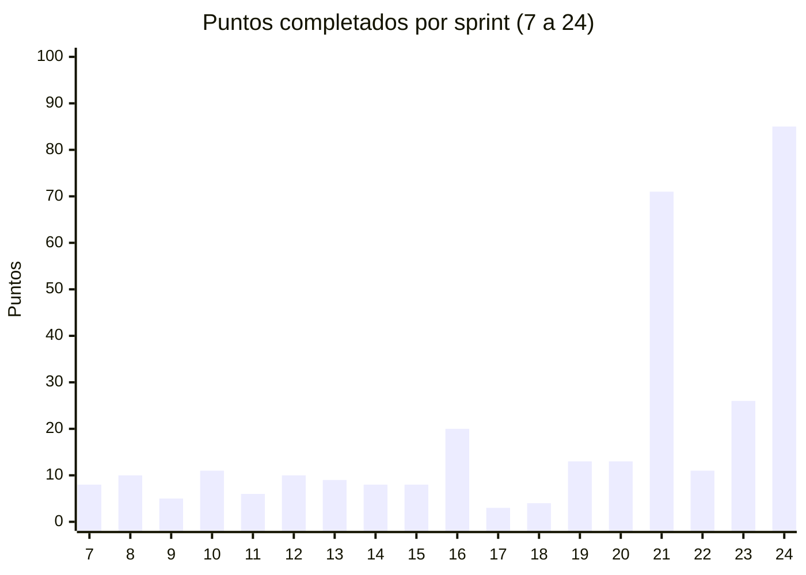

# Parte 3 — Propuesta metodológica, backlog y sprints

> Borrador del 20/10/2026.
>
> - **Sprints 0 a 6 (2023):** salen del TP de Sistemas IV (noviembre 2023), resumidos. En el Word se
>   puede pegar el texto completo de ese TP.
> - **Sprints 7 a 10 (noviembre 2023 – junio 2024):** no hay git; se reconstruyeron a partir de los
>   respaldos del código y la base, el plan de pruebas y la presentación de PP1. Fechas y reuniones
>   estimativas.
> - **Sprints 11 a 24 (septiembre 2024 – octubre 2026):** **reconstruidos del historial del
>   repositorio** (fechas y contenido de los commits). Las ceremonias son **estimativas**: se ubicaron
>   en las fechas en que hubo commits y su contenido resume lo que muestran. Los puntos de historia
>   también son estimados después del hecho.
> - Los períodos sin commits figuran como pausas, sin sprints planificados.

---

## Propuestas metodológicas

Para el desarrollo de SGTL se eligió **Scrum**, un marco de trabajo ágil e incremental. La elección
responde a tres características del proyecto: los requerimientos se fueron precisando a medida que
la empresa veía el sistema funcionando (el caso más claro es la proforma de Rukas, rediseñada después
de relevar la plataforma del cliente); el equipo es chico y estudia y trabaja en simultáneo; y la
cátedra evalúa avances parciales, lo que encaja con entregas incrementales.

El equipo aplicó Scrum de manera adaptada:

- **Iteraciones de dos semanas**, cada una con un objetivo y un conjunto de historias del Product
  Backlog. Hubo períodos sin sprints planificados.
- **Roles.** Product Owner: Mariel Ferrando. Scrum Master: Facundo Godoy. Analista funcional:
  Claudia Sánchez. Equipo de desarrollo: Rocío Nuvoli, Federico Montenegro y Facundo Godoy.
  Testing: Rocío Nuvoli y Claudia Sánchez.
- **Ceremonias.** Planificación al inicio del sprint; reuniones diarias breves por Meet o WhatsApp;
  revisión del incremento con la Product Owner o entre el equipo; retrospectiva al cierre.
- **Artefactos.** Product Backlog organizado en épicas; Sprint Backlog; incremento integrado en la
  rama `main` del repositorio y probado en la máquina virtual de pruebas.
- **Métricas.** Capacidad del equipo (puntos comprometidos y completados) y burndown por sprint.
- **Herramientas.** Jira (2023) y planillas de Excel (2024) para el backlog; GitHub para el código;
  Google Drive para la documentación; WhatsApp y Meet para la comunicación.

---

## Sprint 0

### Objetivo

Definir el rol de cada integrante, las herramientas y plataformas a utilizar y las métricas con las
que se va a medir el avance.

### Roles

| Rol | 2023 (Sistemas IV) | 2024 – 2026 |
|---|---|---|
| Product Owner | Mariel Ferrando | Mariel Ferrando |
| Scrum Master | Facundo Godoy | Facundo Godoy |
| Analista funcional | — | Claudia Sánchez |
| Development team | Rocío Nuvoli, Federico Montenegro, Claudia Sánchez, Juan Castañar | Rocío Nuvoli, Federico Montenegro, Facundo Godoy |
| Tester team | Rocío Nuvoli, Claudia Sánchez | Rocío Nuvoli, Claudia Sánchez |
| Contacto de la empresa | — | Claudia Sánchez |

En los primeros sprints de 2023 también participaron Andrea Avaro y Agustín Bobadilla (planificación
de los sprints 1 a 3 del TP de Sistemas IV).

### Herramientas

**Comunicación**

- **Microsoft Teams y Google Meet:** reuniones por video, con pantalla compartida.
- **WhatsApp:** grupo del equipo para el contacto inmediato.
- **Correo electrónico:** comunicación con los docentes.

**Backlog y documentación**

- **Jira Software (2023):** backlog, tablero del sprint y gráficos.
- **Microsoft Excel (2024 en adelante):** registro de los sprints y gráficos de capacidad.
- **Google Drive:** documentación del proyecto.
- **GitHub (desde septiembre 2024):** repositorio `TransporteSanchez/SGTL`, con una rama por
  integrante (`rocionuvoli`, `facugodoy`, `fedemontenegro`), `main` para lo probado y `master` para la
  versión final.

**Plataforma tecnológica del producto**

- **Visual Studio 2019/2022:** desarrollo y compilación de la API.
- **Visual Studio Code con Live Server:** desarrollo de las pantallas.
- **SQL Server Management Studio:** administración de la base.
- **Máquina virtual con Windows:** ambiente de pruebas donde se compila y se prueba cada cambio.

**Lenguajes y frameworks**

- **HTML5, CSS3 y JavaScript** con **jQuery** y **Bootstrap 5:** pantallas.
- **C# con ASP.NET Web API 2 (.NET Framework 4.8)** y **Entity Framework 6:** API REST.
- **SQL Server / Azure SQL:** base de datos.
- **API de Google Maps, API de WhatsApp Cloud (Meta)** y **SMTP** (MailKit): integraciones.

---

## Backlog del producto

El Backlog del Producto es la lista ordenada de todo lo que el sistema necesita. Lo administra la
Product Owner, que lo armó a partir del relevamiento con Transporte Sánchez, y se actualiza en cada
planificación con lo que surge de las revisiones con la empresa (Claudia Sánchez) y con los docentes.

### Organización

- **Épicas (E1 a E18):** agrupan los ítems por área funcional.
- **Historias de usuario (HU01 a HU53):** numeradas en el orden en que se incorporaron. HU25 se fusionó con HU26 al reconstruir el backlog.
- **Ítems técnicos (T01 a T06):** trabajo sin valor directo para el usuario que consume capacidad
  (repositorio, migración de la base, dependencias).
- **Evolutivos (EV01 a EV12):** funcionalidades para versiones futuras.

### Prioridad y estimación

| Prioridad | Criterio |
|---|---|
| Alta | Sin el ítem no se puede registrar, facturar o cobrar un viaje, o compromete la seguridad o la integridad de los datos. |
| Media | Mejora el control, la calidad de la información o la eficiencia de una tarea que ya se puede hacer. |
| Baja | Deseable: mejora la presentación o la comodidad, sin impacto en la operación. |

La estimación se hace en **puntos de historia** (1, 2, 3, 5, 8, 13, 21), una medida relativa que
combina complejidad, esfuerzo e incertidumbre, tomando como referencia historias ya terminadas.

### Definición de listo y de terminado

Una historia está **lista** para entrar a un sprint cuando:

- está redactada como "como, quiero, para", con criterios de aceptación verificables;
- el equipo la estimó y no depende de otra historia sin terminar;
- la Product Owner la validó, y también la empresa cuando cambia una regla del negocio.

Una historia está **terminada** cuando:

- el código está en la rama del integrante y se integró en `main`;
- los cambios de base de datos están en un script numerado e idempotente en `database/`;
- se compiló y se probó en la máquina virtual, y quedó un reporte de la prueba;
- se presentó en la revisión y la documentación (manual o diseño) quedó actualizada.

### Resumen por épica

| Épica | Objetivo | Ítems | Pts | Sprints | Estado |
|---|---|---|---|---|---|
| E1 – Acceso y seguridad | Login, sesión con JWT, usuarios, grupos y permisos. | 8 | 63 | 1–3, 7–10, 12, 13, 16, 20, 21, 24 | Terminada (seguridad avanzada en EV) |
| E2 – Flota y personal | Camiones y choferes. | 7 | 34 | 1, 3, 14–17 | Terminada |
| E3 – Clientes | Clientes directos y con plataforma. | 3 | 13 | 7–10, 16, 18 | Terminada |
| E4 – Recorridos | Orígenes, destinos y localidades. | 3 | 15 | 7–10, 21, 24 | Terminada |
| E5 – Tarifas | Tarifas fijas y por km. | 2 | 16 | 19, 21 | Terminada |
| E6 – Viajes | Registro, estados, mapa y reglas. | 8 | 60 | 6–10, 19, 21, 22, 24 | Terminada |
| E7 – Presupuestos | Presupuestos y viaje desde presupuesto. | 1 | 8 | 24 | Terminada |
| E8 – Proformas propias | Proforma de clientes directos. | 1 | 13 | 21 | Terminada |
| E9 – Proforma de plataforma | Importar y controlar la proforma de Rukas. | 1 | 21 | 24 | Terminada |
| E10 – Facturación | Factura, notas de crédito y débito, configuración. | 3 | 16 | 21, 23 | Terminada |
| E11 – Cuenta corriente | Saldos, recibos e imputaciones. | 2 | 16 | 22, 23 | Terminada |
| E12 – Comunicaciones | Correo y WhatsApp. | 2 | 13 | 23, 24 | Terminada |
| E13 – Auditoría | Registro y consulta de cambios. | 2 | 13 | 16, 21 | Terminada |
| E14 – Información para la dirección | Tablero de inicio y exportaciones. | 1 | 5 | 21 | Terminada |
| E15 – Interfaz | Diseño, gestión de contenido y design system. | 4 | 21 | 4–6, 11, 12, 14, 24 | Terminada (aplicar a todas las pantallas en EV) |
| E16 – Calidad y documentación | Base de datos, pruebas, manual. | 4 | 29 | 2, 3, 7–10, 24 | En curso (prueba del sistema) |
| E17 – Infraestructura | Repositorio, Azure SQL y dependencias. | 6 | 17 | 11, 13, 16, 18, 22, 24 | Terminada |
| E18 – Evolutivos | Versiones futuras. | 12 | 139 (prelim.) | — | Backlog futuro |

> Los totales por épica y por sprint son estimados. Revisar la suma cuando se cierre la lista de
> ítems.

### Ítems por épica

| ID | Ítem | Prioridad | Pts | Sprint | Estado |
|---|---|---|---|---|---|
| **E1 – Acceso y seguridad** | | | | | |
| HU01 | Ingresar al sistema | Alta | 8 | 1–3 | Terminada |
| HU11 | Usuarios, grupos y menú | Alta | 8 | 10 | Terminada |
| HU15 | Nuevo login (pantalla y API) | Alta | 8 | 12 | Terminada |
| HU16 | Sesión con JWT, roles y cierre de sesión | Alta | 8 | 13 | Terminada |
| HU22 | Ajustes de usuarios y grupos | Media | 5 | 16 | Terminada |
| HU28 | Menú dinámico y permisos por grupo (API) | Alta | 13 | 20 | Terminada |
| HU33 | Permisos por grupo en pantallas y menú lateral | Alta | 8 | 21 | Terminada |
| HU51 | Correcciones de seguridad de la recorrida (contraseñas, permisos) | Alta | 5 | 24 | Terminada |
| **E2 – Flota y personal** | | | | | |
| HU02 | Registrar datos de vehículos | Alta | 5 | 1, 3 | Terminada |
| HU03 | Registrar datos de choferes | Alta | 5 | 1, 3 | Terminada |
| HU05 | Listados de choferes y camiones | Alta | 5 | 3 | Terminada |
| HU18 | Mejoras en gestión y listado de choferes | Media | 5 | 14 | Terminada |
| HU19 | Baja lógica y validaciones en choferes y camiones | Alta | 8 | 15 | Terminada |
| HU20 | Estado "Eliminado" en chofer y camión | Media | 3 | 16 | Terminada |
| HU24 | Validaciones de choferes y camiones (pantalla y API) | Media | 3 | 17 | Terminada |
| **E3 – Clientes** | | | | | |
| HU09 | Clientes | Alta | 5 | 8 | Terminada |
| HU23 | Gestión de clientes (rediseño) | Media | 5 | 16 | Terminada |
| HU13 | Puesta a punto de gestión de clientes | Media | 3 | 18 | Terminada |
| **E4 – Recorridos** | | | | | |
| HU10 | Orígenes, destinos, provincias y localidades | Alta | 5 | 9 | Terminada |
| HU32 | Pantalla de orígenes y destinos | Alta | 8 | 21 | Terminada |
| HU52 | Localidades del catálogo oficial (Georef) | Media | 2 | 24 | Terminada |
| **E5 – Tarifas** | | | | | |
| HU26 | Tarifas fijas y por km (API) | Alta | 8 | 19 | Terminada |
| HU30 | Pantalla de tarifas | Alta | 8 | 21 | Terminada |
| **E6 – Viajes** | | | | | |
| HU07 | Modelos de pantalla de viajes | Media | 3 | 6 | Terminada |
| HU08 | Registro y listado de viajes | Alta | 13 | 7, 8 | Terminada |
| HU27 | Viajes con tarifa | Alta | 5 | 19 | Terminada |
| HU29 | Rediseño del registro de viajes | Alta | 13 | 21 | Terminada |
| HU37 | Ajustes de viajes | Media | 3 | 22 | Terminada |
| HU43 | Viajes directos y con plataforma: estados, evidencia y números de Rukas | Alta | 13 | 24 | Terminada |
| HU45 | Ruta y distancia con Google Maps | Alta | 5 | 24 | Terminada |
| HU46 | Reglas de edición según el estado del viaje | Alta | 5 | 24 | Terminada |
| **E7 – Presupuestos** | | | | | |
| HU47 | Presupuestos con PDF, envío y viaje desde el presupuesto | Media | 8 | 24 | Terminada |
| **E8 – Proformas propias** | | | | | |
| HU31 | Proforma de clientes directos | Alta | 13 | 21 | Terminada |
| **E9 – Proforma de plataforma** | | | | | |
| HU48 | Proforma de Rukas: importar, controlar, reclamar y generar | Alta | 21 | 24 | Terminada |
| **E10 – Facturación** | | | | | |
| HU36 | Factura desde la proforma y PDF | Alta | 8 | 21 | Terminada |
| HU40 | Configuración de facturación y comprobantes (NC, ND) | Alta | 5 | 23 | Terminada |
| HU42 | Permisos de facturación | Alta | 3 | 23 | Terminada |
| **E11 – Cuenta corriente** | | | | | |
| HU38 | Maqueta de cuenta corriente | Media | 3 | 22 | Terminada |
| HU39 | Cuenta corriente de clientes y recibos | Alta | 13 | 23 | Terminada |
| **E12 – Comunicaciones** | | | | | |
| HU41 | Configuración de correo (SMTP) y envío de comprobantes | Media | 5 | 23 | Terminada |
| HU44 | Hoja de ruta al chofer por WhatsApp | Media | 8 | 24 | Terminada |
| **E13 – Auditoría** | | | | | |
| HU21 | Usuario y fechas de alta y modificación en las entidades | Media | 5 | 16 | Terminada |
| HU34 | Auditoría automática y pantalla de consulta | Alta | 8 | 21 | Terminada |
| **E14 – Información para la dirección** | | | | | |
| HU35 | Tablero de inicio con indicadores | Media | 5 | 21 | Terminada |
| **E15 – Interfaz** | | | | | |
| HU06 | Mejoras estéticas de las pantallas de registro | Baja | 5 | 4–6 | Terminada |
| HU14 | Gestión de contenido (logo, colores, pie) | Baja | 5 | 11, 12 | Terminada |
| HU17 | Títulos de módulos y menús | Baja | 3 | 14 | Terminada |
| HU50 | Design system y piloto en Choferes | Media | 8 | 24 | Terminada (falta aplicarlo al resto: EV) |
| **E16 – Calidad y documentación** | | | | | |
| HU04 | Diseño y creación de la base de datos | Alta | 13 | 2, 3 | Terminada |
| HU12 | Plan de pruebas del módulo Choferes | Media | 3 | 10 | Terminada |
| HU49 | Manual de usuario en línea e informes de versión | Media | 5 | 24 | Terminada |
| HU53 | Prueba del sistema y documentación de la tesis | Alta | 8 | 24 | En curso |
| **E17 – Infraestructura** | | | | | |
| T01 | Repositorio en GitHub con ramas por integrante | Alta | 3 | 11 | Terminada |
| T02 | Chequeo de estado de la API (Health) | Baja | 1 | 13 | Terminada |
| T03 | Base de datos actualizada y respaldo | Media | 2 | 16 | Terminada |
| T04 | Ajustes de pantallas y depuración | Baja | 1 | 18 | Terminada |
| T05 | Migración de la base a Azure SQL | Alta | 5 | 22 | Terminada |
| T06 | Dependencias con alertas de seguridad (Dependabot) | Media | 5 | 24 | Terminada |

### Backlog pendiente

Lo que falta construir, en el orden de prioridad propuesto.

| Orden | ID | Ítem | Prioridad | Pts | Destino |
|---|---|---|---|---|---|
| 1 | EV01 | **Seguridad de la API y las contraseñas.** Token obligatorio en todos los endpoints y contraseñas guardadas con hash. Detectado en la recorrida del 17/10 (F1b). | Alta | 13 | Próximo sprint |
| 2 | EV02 | **Hora de Argentina en todo el sistema.** Hoy la base guarda en UTC, la API en hora local y el navegador en UTC (§2 de pendientes). | Alta | 8 | Próximo sprint |
| 3 | EV03 | **Credenciales fuera del repositorio.** Sacar la cadena de conexión y la copia vieja del proyecto (`repositorio.zip`) y rotar la contraseña de la base. | Alta | 3 | Próximo sprint |
| 4 | EV04 | **Design system en todas las pantallas.** | Media | 13 | Futuro |
| 5 | EV05 | **Cambiar contraseña con código por WhatsApp.** | Media | 8 | Futuro |
| 6 | EV06 | **Reenviar la hoja de ruta y avisar la baja del viaje por WhatsApp.** | Media | 5 | Futuro |
| 7 | EV07 | **Direcciones con Google Places y desplegables con búsqueda.** | Media | 8 | Futuro |
| 8 | EV08 | **Integración con ARCA** (factura electrónica con CAE). | Alta | 21 | Futuro |
| 9 | EV09 | **Mantenimiento de unidades y vencimientos** (ITV, seguros, frío, licencias). | Media | 13 | Futuro |
| 10 | EV10 | **Gastos de viaje, proveedores y su cuenta corriente.** | Media | 13 | Futuro |
| 11 | EV11 | **Integración por API con plataformas de clientes** y nuevas plataformas además de Rukas. | Baja | 21 | Futuro |
| 12 | EV12 | **Pruebas automatizadas** de la API. | Media | 13 | Futuro |

### Velocidad del equipo

Los puntos de los sprints 1 a 6 se registraron en Jira y sus gráficos están en el TP de Sistemas IV.

| Sprint | Período | Comprometidos | Completados |
|---|---|---|---|
| 7 | 06/11 – 19/11/2023 | 13 | 8 |
| 8 | 08/04 – 21/04/2024 | 10 | 10 |
| 9 | 06/05 – 19/05/2024 | 5 | 5 |
| 10 | 27/05 – 17/06/2024 | 11 | 11 |
| 11 | 09/09 – 22/09/2024 | 8 | 6 |
| 12 | 23/09 – 06/10/2024 | 10 | 10 |
| 13 | 28/10 – 10/11/2024 | 9 | 9 |
| 14 | 06/01 – 19/01/2025 | 8 | 8 |
| 15 | 20/01 – 02/02/2025 | 8 | 8 |
| 16 | 10/03 – 26/03/2025 | 20 | 20 |
| 17 | 07/04 – 20/04/2025 | 3 | 3 |
| 18 | 30/03 – 12/04/2026 | 4 | 4 |
| 19 | 04/05 – 17/05/2026 | 13 | 13 |
| 20 | 18/05 – 31/05/2026 | 13 | 13 |
| 21 | 20/07 – 02/08/2026 | 71 | 71 |
| 22 | 03/08 – 16/08/2026 | 11 | 11 |
| 23 | 28/09 – 11/10/2026 | 26 | 26 |
| 24 | 12/10 – 25/10/2026 | 93 | 85 (en curso) |

La velocidad habitual del equipo estuvo entre 5 y 26 puntos por sprint, porque se trabajaba en
paralelo con el cursado. Los sprints 21 y 24 se planificaron como **sprints intensivos**, con el
equipo dedicado al proyecto durante las dos semanas: el 21 para llegar a un producto mínimo con el
circuito viaje → proforma → factura, y el 24 para integrar los módulos de todos y llegar probado a la
presentación. Por eso tienen 71 y 93 puntos. En los dos se mantuvo la duración de dos semanas.

---

## Sprint 1

### Objetivo

Diseñar los modelos de las primeras pantallas del sistema: login, registro de camiones y registro de choferes.

### Ceremonia de planificación

- Fecha de inicio: 24/05/2023 · Fecha de fin: 07/06/2023 · Duración: 2 semanas
- Product Owner: Mariel Ferrando · Scrum Master: Facundo Godoy
- Development team: Claudia Sánchez, Federico Montenegro, Andrea Avaro, Agustín Bobadilla
- Producto: Sistema de Gestión Transporte Sánchez

Junto con la Product Owner se identificaron los elementos del backlog para este sprint: pantalla de Login, Registro de camiones y Registro de choferes. Se comenzó por el diseño de los modelos.

### Historias de usuario

| HU01 – Ingresar al sistema |
|---|
| **Como:** dueño de la empresa. **Quiero:** acceder al sistema de gestión de la empresa. **Para:** supervisar y administrar las operaciones, acceder a los informes y tomar decisiones. **Criterios de aceptación:** login seguro que requiera credenciales; acceso restringido y protección de la información confidencial; interfaz fácil de usar. |

| HU02 – Registrar datos de vehículos |
|---|
| **Como:** usuario administrativo. **Quiero:** ingresar los datos de los camiones de la empresa. **Para:** controlar las fechas de mantenimiento y registrar los viajes con los datos del camión. **Criterios de aceptación:** registrar las fechas de ITV y de mantenimiento del equipo de frío; registrar marca y dominio; visualizar y buscar los datos de cada vehículo. |

| HU03 – Registrar datos de choferes |
|---|
| **Como:** usuario administrativo. **Quiero:** ingresar los datos de los choferes. **Para:** mantener un registro actualizado y asegurar que cumplan los requisitos legales para operar los vehículos. **Criterios de aceptación:** datos personales (nombre, apellido, fecha de nacimiento, documento, domicilio, teléfono y correo); documentación legal (licencia y certificados); registro de horas de conducción. |

### Backlog del sprint

| ID | Ítem | Estado al cierre |
|---|---|---|
| HU01 | Ingresar al sistema (modelo) | Modelo terminado |
| HU02 | Registrar datos de vehículos (modelo) | Modelo terminado |
| HU03 | Registrar datos de choferes (modelo) | Modelo terminado |

### Reuniones diarias

- **02/06:** presentación de los avances en los modelos.
- **06/06:** redefinición del modelo de Login, teniendo en cuenta su codificación.

### Ceremonia de revisión

07/06, con Mariel Ferrando: se mostraron los modelos de Registro de camiones y Registro de choferes. Propuso quitar el campo Sexo en la carga de choferes y agregar la fecha de mantenimiento en la carga de camiones.

### Ceremonia de retrospectiva

Se identificó la necesidad de mejorar la comunicación, hacer las dailies con menos días entre ellas y no excederse en su duración; se programaron reuniones obligatorias con tiempo y temas definidos. Para el próximo sprint: comenzar el desarrollo del Login y de los registros, y el diseño conceptual de la base de datos.

---

## Sprint 2

### Objetivo

Codificar las pantallas modeladas y crear la base de datos.

### Ceremonia de planificación

- Fecha de inicio: 07/06/2023 · Fecha de fin: 21/06/2023 · Duración: 2 semanas
- Product Owner: Mariel Ferrando · Scrum Master: Facundo Godoy
- Development team: Claudia Sánchez, Federico Montenegro, Andrea Avaro, Agustín Bobadilla
- Producto: Sistema de Gestión Transporte Sánchez

Según lo acordado en la retrospectiva, se plantearon las tareas para codificar las pantallas y se planificó el modelado y la creación de la base de datos.

### Historias de usuario

| HU04 – Diseño y creación de la base de datos |
|---|
| **Como:** equipo de desarrollo. **Quiero:** un modelo de datos y su base en SQL Server. **Para:** guardar la información del sistema de forma consistente. **Criterios de aceptación:** modelo conceptual revisado por el equipo; base creada en SQL Server Express; clases de la API alineadas con las tablas. |

### Backlog del sprint

| ID | Ítem | Estado al cierre |
|---|---|---|
| HU01 | Ingresar al sistema (codificación) | En curso |
| HU02 | Registrar datos de vehículos (codificación) | En curso |
| HU04 | Diseño y creación de la base de datos | Primera versión; pasa a mejoras |

### Reuniones diarias

- **09/06:** avances en el desarrollo del Login.
- **11/06:** avances en la pantalla de Registro de camiones.
- **13/06:** no se concretó.
- **16/06:** puesta en común del modelo conceptual de la base.
- **19/06:** avances en la creación de la base en SQL Server Express.

### Ceremonia de revisión

21/06: no se pudo hacer con la Product Owner; el equipo revisó los temas pendientes para cerrar el sprint. Con el profesor Mario Barrionuevo se revisó la base y propuso quitar tablas y cambiar relaciones.

### Ceremonia de retrospectiva

Se acordó cambiar el diseño y las relaciones de las tablas y actualizar las clases de la API según esos cambios.

---

## Sprint 3

### Objetivo

Aplicar las mejoras de la base, integrar aplicación, API y base, y sumar los listados.

### Ceremonia de planificación

- Fecha de inicio: 21/06/2023 · Fecha de fin: 05/07/2023 · Duración: 2 semanas
- Product Owner: Mariel Ferrando · Scrum Master: Facundo Godoy
- Development team: Claudia Sánchez, Federico Montenegro, Andrea Avaro, Agustín Bobadilla
- Producto: Sistema de Gestión Transporte Sánchez

Primero las mejoras propuestas por el profesor Mario Barrionuevo; después, los modelos y la creación de las pantallas Listado de choferes y Listado de camiones.

### Historias de usuario

| HU05 – Listados de choferes y camiones |
|---|
| **Como:** usuario administrativo. **Quiero:** listar los choferes y los camiones registrados. **Para:** consultarlos y encontrarlos rápido. **Criterios de aceptación:** listado con búsqueda por nombre, apellido y DNI (choferes) y por dominio (camiones); datos traídos desde la base. |

### Backlog del sprint

| ID | Ítem | Estado al cierre |
|---|---|---|
| HU01 | Ingresar al sistema | Terminada |
| HU02 | Registrar datos de vehículos | Terminada |
| HU03 | Registrar datos de choferes | Terminada |
| HU04 | Diseño y creación de la base de datos | Terminada |
| HU05 | Listados de choferes y camiones | Terminada |

### Reuniones diarias

- **23/06:** puesta en común de la integración aplicación + API + base.
- **28/06:** avances de la integración; comienzan los cambios en las clases de la API y en la base.
- **30/06:** modelos de Listado de choferes y de camiones, con ideas de mejora.
- **01/07:** comienza la creación de las pantallas de listados.

### Ceremonia de revisión

05/07, con Mariel Ferrando: se mostró la aplicación funcionando (Login, registros y listados de choferes y camiones). Pidió cambiar el color de los botones, alinear los campos a la izquierda, dar transparencia a los campos y poner las etiquetas en negrita.

### Ceremonia de retrospectiva

Se identificaron varias mejoras estéticas para los registros de choferes y camiones.

---

## Sprint 4

### Objetivo

Aplicar las mejoras estéticas pedidas por la Product Owner, tomando como referencia sistemas del rubro.

### Ceremonia de planificación

- Fecha de inicio: 23/08/2023 · Fecha de fin: 06/09/2023 · Duración: 2 semanas
- Product Owner: Mariel Ferrando · Scrum Master: Facundo Godoy
- Development team: Claudia Sánchez, Federico Montenegro, Rocío Nuvoli, Juan Castañar
- Producto: Sistema de Gestión Transporte Sánchez

Se priorizaron las mejoras pedidas en el sprint anterior y se sumó la tarea de analizar diseños de empresas del rubro. En este sprint se incorporaron Rocío Nuvoli y Juan Castañar.

### Historias de usuario

| HU06 – Mejoras estéticas de las pantallas de registro |
|---|
| **Como:** usuario administrativo. **Quiero:** pantallas de registro más claras. **Para:** cargar los datos con menos errores. **Criterios de aceptación:** sin el campo Sexo en choferes; fecha de mantenimiento en camiones; colores, alineación y etiquetas según lo pedido en la revisión. |

### Backlog del sprint

| ID | Ítem | Estado al cierre |
|---|---|---|
| HU06 | Mejoras estéticas (campos pedidos) | Terminada la parte de campos; el resto sigue |

### Reuniones diarias

- **25/08:** se fijaron las prioridades: primero las dos mejoras pedidas por la Product Owner.
- **30/08:** se quitó el campo Sexo y se agregó la fecha de mantenimiento.
- **05/09:** ideas para el resto de las mejoras estéticas y búsqueda de sistemas del rubro.
- **06/09:** onboarding de los nuevos integrantes.

### Ceremonia de revisión

06/09, entre el equipo: relevamiento de las mejoras estéticas pendientes.

### Ceremonia de retrospectiva

Mejorar los tiempos de trabajo y organizar las tareas según las habilidades y conocimientos de cada integrante.

---

## Sprint 5

### Objetivo

Investigar modelos de diseño de otros sistemas del rubro para decidir los cambios de diseño.

### Ceremonia de planificación

- Fecha de inicio: 27/09/2023 · Fecha de fin: 11/10/2023 · Duración: 2 semanas
- Product Owner: Mariel Ferrando · Scrum Master: Facundo Godoy
- Development team: Claudia Sánchez, Federico Montenegro, Rocío Nuvoli, Juan Castañar
- Producto: Sistema de Gestión Transporte Sánchez

Se retomaron las tareas pendientes del sprint anterior, priorizando la investigación de diseños antes de cambiar las pantallas.

### Backlog del sprint

| ID | Ítem | Estado al cierre |
|---|---|---|
| HU06 | Mejoras estéticas (investigación de diseños) | En curso |

### Reuniones diarias

- **05/10:** presentación de la investigación de diseños de empresas del rubro.
- **06/10:** se anotaron las ideas para las mejoras de Registro de choferes y de camiones.
- **10/10:** se plantearon nuevas mejoras; quedó pendiente cargarlas como tareas.

### Ceremonia de revisión

11/10, entre el equipo: relevamiento de las tareas pendientes.

### Ceremonia de retrospectiva

Hace falta más conocimiento de normas de diseño UX/UI; se sumarán tareas relacionadas.

---

## Sprint 6

### Objetivo

Definir las buenas prácticas de diseño a aplicar y comenzar los modelos del módulo de viajes.

### Ceremonia de planificación

- Fecha de inicio: 11/10/2023 · Fecha de fin: 25/10/2023 · Duración: 2 semanas
- Product Owner: Mariel Ferrando · Scrum Master: Facundo Godoy
- Development team: Claudia Sánchez, Federico Montenegro, Rocío Nuvoli, Juan Castañar
- Producto: Sistema de Gestión Transporte Sánchez

Se continuó con las tareas pendientes, con puestas en común e investigación técnica de cómo aplicar las mejoras. Además se comenzó con los modelos de Registro de viajes y Listado de viajes.

### Historias de usuario

| HU07 – Modelos de pantalla de viajes |
|---|
| **Como:** usuario administrativo. **Quiero:** ver cómo van a ser las pantallas de registro y listado de viajes. **Para:** validarlas antes de codificarlas. **Criterios de aceptación:** modelos de Registro de viajes y Listado de viajes revisados por el equipo. |

### Backlog del sprint

| ID | Ítem | Estado al cierre |
|---|---|---|
| HU06 | Mejoras estéticas de las pantallas de registro | Terminada |
| HU07 | Modelos de pantalla de viajes | Terminada |

### Reuniones diarias

- **13/10:** se decidió investigar las mejores prácticas para las mejoras pendientes.
- **16/10:** relevamiento de los temas que requieren asesoramiento docente.
- **19/10:** comienzan los modelos de Registro y Listado de viajes.

### Ceremonia de revisión

25/10, entre el equipo: se revisó el trabajo pendiente para ordenar las prioridades del próximo sprint.

### Ceremonia de retrospectiva

El equipo coincidió en mejorar la capacidad de trabajo, reorganizando prioridades y revisando la asignación de tareas. Para el Sprint 7: mejoras estéticas, modelos de viajes y comenzar a codificar el módulo de viajes.

---

Los gráficos de capacidad y burndown del Sprint 6 están en el TP de Sistemas IV.

---

Equipo de estos sprints: Product Owner Mariel Ferrando; Scrum Master Facundo Godoy; development team
Rocío Nuvoli, Federico Montenegro, Claudia Sánchez y Juan Castañar; tester team Rocío Nuvoli y
Claudia Sánchez.

## Sprint 7

### Objetivo

Comenzar la codificación del módulo de viajes, como se acordó en la retrospectiva del Sprint 6.

### Ceremonia de planificación

Inicio: 06/11/2023 · Fin: 19/11/2023 · 2 semanas.

Se tomaron los modelos de Registro y Listado de viajes del sprint anterior. Por tamaño se priorizó el
registro y el listado quedó para el sprint siguiente.

### Historias de usuario

| HU08 – Registro y listado de viajes |
|---|
| **Como:** encargada administrativa. **Quiero:** registrar cada viaje con cliente, origen, destino, fechas, camión y chofer, y consultarlos en un listado. **Para:** tener el control de los viajes realizados y a realizar. **Criterios de aceptación:** el camión y el chofer se eligen de los registrados y activos; las fechas de fin no pueden ser anteriores a las de inicio; se registran el número de remito y de carga; el listado se filtra por fecha y por cliente. |

### Backlog del sprint

| ID | Ítem | Épica | Pts | Estado al cierre |
|---|---|---|---|---|
| HU08 | Registro y listado de viajes | E6 | 13 | Registro terminado (8); el listado pasa al Sprint 8 |

### Reuniones diarias

- **08/11:** se definieron los campos del viaje y su relación con camiones y choferes en la base.
- **13/11:** avances en la API de viajes (alta y consulta).
- **16/11:** primera versión de la pantalla de registro conectada a la API.

### Ceremonia de revisión (19/11)

Se mostró el registro de viajes funcionando. La Product Owner pidió poder filtrar los viajes por
cliente, lo que obliga a tener un ABM de clientes.

### Ceremonia de retrospectiva

El módulo de viajes depende de datos que todavía no existen (clientes, orígenes y destinos). Se
acordó construirlos antes de seguir ampliando viajes.

## Sprint 8

### Objetivo

Registrar los clientes y terminar el listado de viajes.

Inicio: 08/04/2024 · Fin: 21/04/2024 · 2 semanas.

| HU09 – Clientes |
|---|
| **Como:** encargada administrativa. **Quiero:** registrar los clientes con razón social, CUIT, condición fiscal y domicilio. **Para:** asociarlos a los viajes y facturarles. **Criterios de aceptación:** CUIT obligatorio y con formato válido; no se repite el CUIT; provincia y localidad se eligen de una lista. |

| ID | Ítem | Épica | Pts | Estado |
|---|---|---|---|---|
| HU09 | Clientes | E3 | 5 | Terminada |
| HU08 | Listado de viajes (resto) | E6 | 5 | Terminada |
| | Total | | 10 | 10 completados |

**Reuniones diarias:** 10/04 modelo de clientes en la base; 15/04 API y pantalla de
clientes; 18/04 listado de viajes con filtros por fecha y cliente.

**Revisión (21/04):** se mostraron clientes y el listado de viajes. Se tomó un respaldo de la base
(20/04/2024) antes de los cambios del sprint siguiente.

**Retrospectiva:** tomar respaldos de la base antes de cada cambio grande de estructura.

## Sprint 9

### Objetivo

Que cada viaje tenga un origen y un destino con dirección y localidad.

Inicio: 06/05/2024 · Fin: 19/05/2024.

| HU10 – Orígenes, destinos, provincias y localidades |
|---|
| **Como:** encargada administrativa. **Quiero:** registrar los lugares de carga y de entrega de cada cliente con su dirección. **Para:** elegirlos al registrar el viaje en lugar de escribirlos. **Criterios de aceptación:** cada origen y destino pertenece a un cliente; provincia y localidad desde el catálogo; el viaje solo ofrece los orígenes y destinos del cliente elegido. |

| ID | Ítem | Épica | Pts | Estado |
|---|---|---|---|---|
| HU10 | Orígenes, destinos, provincias y localidades | E4 | 5 | Terminada |

**Reuniones diarias:** 08/05 catálogo de provincias y localidades; 13/05 orígenes y
destinos por cliente; 15/05 se integró todo en la versión v2 del código.

**Revisión (19/05):** viaje con origen y destino elegidos del cliente. Se guardó la versión v2.1
(18/05/2024).

**Retrospectiva:** guardar una versión del código al cierre de cada sprint, mientras no haya un
repositorio compartido (se resolvió en el Sprint 11 con GitHub).

## Sprint 10

### Objetivo

Controlar el acceso al sistema por usuario y grupo, y dejar escrito el plan de pruebas de un módulo
para la presentación de Práctica Profesionalizante I.

Inicio: 27/05/2024 · Fin: 17/06/2024 · 3 semanas (se extendió para llegar con el plan de pruebas).

| HU11 – Usuarios, grupos y menú |
|---|
| **Como:** dueño de la empresa. **Quiero:** dar de alta usuarios y agruparlos según lo que pueden usar. **Para:** que cada persona acceda solo a su parte del sistema. **Criterios de aceptación:** ABM de usuarios con estado activo o inactivo; grupos con los menús habilitados; un usuario puede pertenecer a un grupo. |

| HU12 – Plan de pruebas del módulo Choferes |
|---|
| **Como:** tester. **Quiero:** un plan de pruebas del módulo de choferes. **Para:** verificar alta, baja, modificación, activación, listados y filtros. **Criterios de aceptación:** casos con datos de entrada y resultado esperado; ambiente de prueba descripto; versión aprobada por el equipo. |

| ID | Ítem | Épica | Pts | Estado |
|---|---|---|---|---|
| HU11 | Usuarios, grupos y menú | E1 | 8 | Terminada |
| HU12 | Plan de pruebas del módulo Choferes | E16 | 3 | Terminada |
| | Total | | 11 | 11 completados |

**Reuniones diarias:** 29/05 modelo de usuarios, grupos y menús; 02/06 versión v2.2 con
usuarios; 05/06 versión v2.3 con grupos y menú; 12/06 revisión de los casos del plan de pruebas.

**Revisión (17/06):** plan de pruebas de choferes versión 1.5. El 24/06/2024 se presentó el proyecto
en Práctica Profesionalizante I.

**Retrospectiva:** el trabajo con versiones comprimidas del código generaba pisadas entre
integrantes. Se acordó pasar el proyecto a un repositorio con control de versiones al retomar
(Sprint 11, septiembre 2024).

---

## Sprint 11

### Objetivo

Pasar el proyecto a un repositorio compartido con control de versiones y sumar la personalización
visual del sistema.

### Ceremonia de planificación

- Fecha de inicio: 09/09/2024 · Fecha de fin: 22/09/2024 · Duración: 2 semanas
- Product Owner: Mariel Ferrando · Scrum Master: Facundo Godoy
- Analista funcional: Claudia Sánchez
- Development team: Rocío Nuvoli, Federico Montenegro, Facundo Godoy
- Tester team: Rocío Nuvoli, Claudia Sánchez
- Producto: SGTL – Sistema de Gestión de Transporte y Logística

Se priorizó ordenar el código antes de seguir sumando módulos: hasta ese momento cada integrante
trabajaba sobre copias comprimidas del proyecto.

### Historias de usuario

| HU14 – Gestión de contenido |
|---|
| **Como:** administrador del sistema. |
| **Quiero:** cambiar el logo, el color de fondo, el color del menú y el pie de página. |
| **Para:** que el sistema muestre la identidad de Transporte Sánchez. **Criterios de aceptación:** se guardan en la base y se aplican al recargar; el logo se carga desde un archivo o una URL; se pide confirmación antes de guardar. |

| T01 – Repositorio en GitHub |
|---|
| **Como:** equipo de desarrollo. **Quiero:** el proyecto en un repositorio con ramas. **Para:** integrar los cambios sin pisarnos. **Criterios:** repositorio `TransporteSanchez/SGTL`, `.gitignore` para la compilación, rama de pruebas y pull request para integrar. |

### Backlog del sprint

| ID | Ítem | Épica | Prioridad | Pts | Estado al cierre |
|---|---|---|---|---|---|
| T01 | Repositorio en GitHub con ramas | E17 | Alta | 3 | Terminada |
| HU14 | Gestión de contenido (API y pantalla) | E15 | Baja | 5 | Pasa al Sprint 12 (falta el front) |
| | Total | | | 8 | 6 completados |

### Reuniones diarias

- **10/09:** se subió el proyecto y se sacaron del repositorio las carpetas de compilación; se
  quitaron controladores de ejemplo (Values, Home).
- **22/09:** se mostró la API de gestión de contenido y se corrigió un enlace erróneo en clientes.

### Ceremonia de revisión (22/09)

Se integró la rama de pruebas con el pull request #1. Quedó pendiente la pantalla de gestión de
contenido.

### Ceremonia de retrospectiva

Trabajar con ramas evitó perder cambios. Se acordó no subir archivos de compilación y escribir
mensajes de commit descriptivos.

### Gráficos

**[Capacidad y burndown a generar.]**

---

## Sprint 12

### Objetivo

Renovar el ingreso al sistema y terminar la pantalla de gestión de contenido.

### Ceremonia de planificación

Inicio: 23/09/2024 · Fin: 06/10/2024 · 2 semanas · mismo equipo.

### Historias de usuario

| HU15 – Nuevo login |
|---|
| **Como:** usuario de Transporte Sánchez. **Quiero:** ingresar con mi usuario y contraseña en una pantalla nueva. **Para:** acceder solo a lo que me corresponde. **Criterios:** controladores Autenticación y Login separados; mensaje claro si las credenciales no son válidas; redirección al inicio al ingresar. |

### Backlog del sprint

| ID | Ítem | Épica | Pts | Estado |
|---|---|---|---|---|
| HU15 | Nuevo login | E1 | 8 | Terminada |
| HU14 | Gestión de contenido (pantalla) | E15 | 2 (resto) | Terminada |
| | Total | | 10 | 10 completados |

### Reuniones diarias

- **28/09:** Facundo presentó los controladores de Autenticación y Login y la pantalla nueva.
- **29/09:** Federico terminó el front de gestión de contenido.
- **02/10:** integración de los cambios en la rama de pruebas.

### Revisión (06/10) y retrospectiva

Se mostró el login nuevo y la gestión de contenido. Para el próximo sprint: manejar la sesión con
token. Retro: coordinar mejor quién integra para evitar conflictos de merge.

---

## Sprint 13

### Objetivo

Proteger la sesión con token JWT y distinguir roles.

### Ceremonia de planificación

Inicio: 28/10/2024 · Fin: 10/11/2024 · 2 semanas.

### Historias de usuario

| HU16 – Sesión con JWT, roles y cierre de sesión |
|---|
| **Como:** administrador. **Quiero:** que la sesión use un token con el rol del usuario y que se pueda cerrar. **Para:** controlar el acceso. **Criterios:** al ingresar se entrega un token JWT; el rol (admin o usuario) viaja en el token; "Salir" invalida la sesión y vuelve al login. |

### Backlog del sprint

| ID | Ítem | Épica | Pts | Estado |
|---|---|---|---|---|
| HU16 | Sesión con JWT, roles y cierre de sesión | E1 | 8 | Terminada |
| T02 | Chequeo de estado de la API | E17 | 1 | Terminada |
| | Total | | 9 | 9 completados |

### Reuniones diarias

- **02/11:** login con JWT y controlador de cierre de sesión; se quitó la pantalla "Salir".
- **03/11:** ajustes en Autenticación y Logout y en gestión de contenido.
- **04/11:** se agregó el controlador Health para verificar que la API responde.

### Revisión (10/11) y retrospectiva

Pull request #2 integrado. Retro: retomar en enero con
choferes y camiones.

---

## Sprint 14

### Objetivo

Mejorar la gestión de choferes y ordenar los nombres de módulos y menús.

Inicio: 06/01/2025 · Fin: 19/01/2025.

| HU18 – Mejoras en choferes |
|---|
| **Como:** encargada administrativa. **Quiero:** un formulario y un listado de choferes más claros y con filtros. **Para:** encontrar y actualizar rápido a cada chofer. **Criterios:** filtros por nombre, DNI y estado; validación de campos obligatorios; mensajes de error claros. |

| ID | Ítem | Pts | Estado |
|---|---|---|---|
| HU17 | Títulos de módulos y menús | 3 | Terminada |
| HU18 | Mejoras en gestión y listado de choferes | 5 | Terminada |
| | Total | 8 | 8 completados |

**Dailies:** 07/01 títulos de menús (Facundo); 12/01 controlador de choferes; 19/01
formularios de listado y gestión.
**Revisión (19/01):** choferes listos. **Retro:** sumar validaciones también del lado de la API.

---

## Sprint 15

### Objetivo

Que eliminar un chofer o un camión no borre su historia.

Inicio: 20/01/2025 · Fin: 02/02/2025.

| HU19 – Baja lógica en choferes y camiones |
|---|
| **Como:** encargada administrativa. **Quiero:** que al eliminar un chofer o camión quede registrado y no se pierda. **Para:** conservar los viajes en que participó. **Criterios:** se guarda la fecha de eliminación; no aparece en los listados ni se puede modificar; validaciones de campos en los dos módulos. |

| ID | Ítem | Pts | Estado |
|---|---|---|---|
| HU19 | Baja lógica y validaciones | 8 | Terminada |

**Dailies:** 25/01 baja lógica de choferes; 26/01 validaciones y baja lógica de camiones.
**Revisión (02/02):** OK. **Retro:** unificar cómo se muestra un registro eliminado (pasa al Sprint 16).

---

## Sprint 16

### Objetivo

Registrar quién crea y modifica cada dato, y avanzar con usuarios, grupos y clientes.

Inicio: 10/03/2025 · Fin: 26/03/2025 (se extendió unos días).

| HU21 – Usuario y fechas de alta y modificación |
|---|
| **Como:** dueño de la empresa. **Quiero:** saber quién cargó y quién modificó cada registro y cuándo. **Para:** controlar los cambios. **Criterios:** todas las entidades guardan usuario y fecha de alta y de modificación; las pantallas los envían. |

| HU23 – Gestión de clientes |
|---|
| **Como:** encargada administrativa. **Quiero:** registrar y modificar clientes con razón social, CUIT, condición fiscal y domicilio. **Para:** asociarlos a los viajes y facturarles. **Criterios:** CUIT obligatorio; provincia y localidad desde el catálogo. |

| ID | Ítem | Pts | Estado |
|---|---|---|---|
| T03 | Base actualizada y respaldo | 2 | Terminada |
| HU20 | Estado "Eliminado" en chofer y camión | 3 | Terminada |
| HU21 | Usuario y fechas de alta y modificación | 5 | Terminada |
| HU22 | Ajustes de usuarios y grupos | 5 | Terminada |
| HU23 | Gestión de clientes | 5 | Terminada |
| | Total | 20 | 20 completados |

**Dailies:** 03/03 base actualizada; 24/03 estado "Eliminado", cambios en el modelo y en
los controladores, usuarios (Facundo); 25/03 clientes (Federico); 26/03 grupos (Facundo).
**Revisión (26/03):** pull request #3. **Retro:** los cambios en el modelo de Entity Framework
rompieron controladores de otros: avisar antes de tocar el modelo.

---

## Sprint 17

Inicio: 07/04/2025 · Fin: 20/04/2025. **Objetivo:** corregir los errores de validación encontrados
en choferes y camiones.

| ID | Ítem | Pts | Estado |
|---|---|---|---|
| HU24 | Validaciones de choferes y camiones (pantalla y API) | 3 | Terminada |

**Daily (20/04):** correcciones en back y front. **Revisión y retro (20/04):** se cierra la primera
etapa del año.

**Pausa: mayo 2025 – marzo 2026.** Solo hubo ajustes de pantallas y depuración el
17/02/2026 (pull request #4, T04).

---

## Sprint 18

Inicio: 30/03/2026 · Fin: 12/04/2026. **Objetivo:** retomar el proyecto con la puesta a punto de
clientes.

| ID | Ítem | Pts | Estado |
|---|---|---|---|
| T04 | Ajustes de pantallas y depuración | 1 | Terminada |
| HU13 | Puesta a punto de gestión de clientes | 3 | Terminada |

**Daily (09/04):** Federico subió la gestión de clientes actualizada. **Retro:** volver a trabajar
con ramas por integrante.

---

## Sprint 19

Inicio: 04/05/2026 · Fin: 17/05/2026. **Objetivo:** que cada viaje tenga su tarifa.

| HU26 – Tarifas fijas y por km |
|---|
| **Como:** encargada administrativa. **Quiero:** definir tarifas fijas por recorrido y tarifas por kilómetro por período. **Para:** que el importe de cada viaje salga solo. **Criterios:** la tarifa fija es por cliente + origen + destino; la tarifa por km tiene período de vigencia y rango de distancia; el viaje toma la que corresponde. |

| ID | Ítem | Pts | Estado |
|---|---|---|---|
| HU26 | Tarifas fijas y por km (API) | 8 | Terminada |
| HU27 | Viajes con tarifa | 5 | Terminada |
| | Total | 13 | 13 completados |

**Daily (03/05):** primer push de la rama con tarifas y viajes. **Revisión (17/05):** OK.

---

## Sprint 20

Inicio: 18/05/2026 · Fin: 31/05/2026. **Objetivo:** que cada usuario vea solo los menús que le
permite su grupo.

| HU28 – Menú dinámico y permisos por grupo |
|---|
| **Como:** administrador. **Quiero:** asignar a cada grupo los menús que puede usar. **Para:** que cada usuario vea solo lo suyo. **Criterios:** ABM de grupos; asignación de usuarios a grupos; el menú lateral se arma con los permisos del grupo; el administrador ve todo. |

| ID | Ítem | Pts | Estado |
|---|---|---|---|
| HU28 | Menú dinámico y permisos por grupo (API) | 13 | Terminada |

**Dailies:** 18/05 cambios de Facundo e inicio; 20/05 controladores de usuarios, grupos y menú;
25/05 integración de la rama de Facundo.

---

## Sprint 21

Inicio: 20/07/2026 · Fin: 02/08/2026 · sprint intensivo (dedicación completa). **Objetivo:** llegar a un producto mínimo que permita registrar
un viaje y facturarlo.

| HU29 – Rediseño del registro de viajes |
|---|
| **Como:** encargada administrativa. **Quiero:** registrar un viaje eligiendo cliente, recorrido, camión, chofer y tarifa en una sola pantalla. **Para:** tener todos los viajes en un lugar. **Criterios:** la tarifa se completa según el recorrido; se ve el mapa del recorrido; validación de campos obligatorios. |

| HU31 – Proforma de clientes directos |
|---|
| **Como:** encargada administrativa. **Quiero:** armar la proforma del período con los viajes del cliente. **Para:** enviarla al cliente antes de facturar. **Criterios:** estados Borrador, Generada y Aceptada; número correlativo al generar; PDF. |

| HU33 – Permisos por grupo en las pantallas |
|---|
| **Como:** administrador. **Quiero:** que el menú y las pantallas respeten los permisos. **Para:** que nadie entre donde no debe. **Criterios:** pantalla de grupos y permisos; el menú lateral se arma con los permisos del usuario. |

| HU34 – Auditoría |
|---|
| **Como:** dueño. **Quiero:** ver quién creó, modificó o eliminó cada dato y qué cambió. **Para:** controlar la operación. **Criterios:** se registra sola para todas las entidades; pantalla con filtros por usuario, entidad, acción y fecha. |

| ID | Ítem | Pts | Estado |
|---|---|---|---|
| HU29 | Rediseño del registro de viajes | 13 | Terminada |
| HU30 | Pantalla de tarifas | 8 | Terminada |
| HU31 | Proforma de clientes directos | 13 | Terminada |
| HU32 | Pantalla de orígenes y destinos | 8 | Terminada |
| HU33 | Permisos por grupo en pantallas y menú | 8 | Terminada |
| HU34 | Auditoría automática y consulta | 8 | Terminada |
| HU35 | Tablero de inicio | 5 | Terminada |
| HU36 | Factura desde la proforma y PDF | 8 | Terminada |
| | Total | 71 | 71 completados |

**Dailies:** 21/07 Rocío presentó viajes y tarifas; 23/07 mapa, choferes activos e
inactivos y permisos; 27/07 auditoría y tablero; 28/07 facturación basada en proformas y PDF.
**Revisión (28/07):** circuito viaje → proforma → factura completo.
**Retro:** el sprint concentró mucho trabajo; quedó pendiente probar en una máquina aparte.

---

## Sprint 22

Inicio: 03/08/2026 · Fin: 16/08/2026. **Objetivo:** pasar la base a la nube para que todo el equipo
trabaje sobre los mismos datos.

| T05 – Migración a Azure SQL |
|---|
| **Como:** equipo de desarrollo. **Quiero:** una base compartida en Azure. **Para:** probar todos con los mismos datos. **Criterios:** cadenas de conexión a Azure SQL (`sql-tesis`); los artefactos de compilación dejan de versionarse. |

| ID | Ítem | Pts | Estado |
|---|---|---|---|
| T05 | Migración de la base a Azure SQL | 5 | Terminada |
| HU37 | Ajustes de viajes | 3 | Terminada |
| HU38 | Maqueta de cuenta corriente | 3 | Terminada |
| | Total | 11 | 11 completados |

**Dailies:** 02/08 ajustes de viajes; 08/08 conexión a Azure y limpieza del repositorio; 09/08
maqueta de cuenta corriente (Facundo).

**Pausa: 17/08 – 27/09/2026.**

---

## Sprint 23

Inicio: 28/09/2026 · Fin: 11/10/2026. **Objetivo:** cerrar el circuito comercial con la cuenta
corriente de clientes.

| HU39 – Cuenta corriente de clientes |
|---|
| **Como:** encargada administrativa impositiva. **Quiero:** ver por cliente sus facturas, notas de crédito y débito, recibos y saldo. **Para:** saber qué se debe y qué está vencido. **Criterios:** movimientos con saldo acumulado; recibos con formas de pago; imputación de recibos a comprobantes; permisos para emitir y anular. |

| ID | Ítem | Pts | Estado |
|---|---|---|---|
| HU39 | Cuenta corriente de clientes y recibos | 13 | Terminada |
| HU40 | Configuración de facturación y comprobantes | 5 | Terminada |
| HU41 | Configuración de correo y envío de comprobantes | 5 | Terminada |
| HU42 | Permisos de facturación | 3 | Terminada |
| | Total | 26 | 26 completados |

**Dailies:** 03/10 base de la cuenta corriente; 05/10 mejoras y configuración; 06/10
correo SMTP, facturación y permisos.
**Revisión (11/10):** Facundo mostró la cuenta corriente. **Retro:** integrar la rama de Facundo con
viajes antes de seguir.

---

## Sprint 24 (en curso)

Inicio: 12/10/2026 · Fin: 25/10/2026 · sprint intensivo (dedicación completa). **Objetivo:** adaptar el sistema a cómo trabaja el cliente con
plataforma, integrar los módulos de todo el equipo y llegar a la presentación con el sistema probado.

### Historias de usuario

| HU43 – Viajes directos y con plataforma |
|---|
| **Como:** encargada administrativa. **Quiero:** que el viaje siga el circuito según el tipo de cliente. **Para:** facturar bien a cada uno. **Criterios:** directo: Registrado → En viaje → Entregado, con resultado, fecha y evidencia; con plataforma: Registrado → Listo para facturar, con N° de transporte SAP, remito y N° de entrega; Facturado lo pone la factura y lo saca la nota de crédito. |

| HU44 – Hoja de ruta por WhatsApp |
|---|
| **Como:** encargada administrativa. **Quiero:** que al asignar el chofer le llegue la hoja de ruta por WhatsApp. **Para:** no avisarle a mano. **Criterios:** se envía con la API de WhatsApp Cloud; se reenvía si cambian chofer, origen, destino o fecha; si falla, el viaje se guarda igual y avisa. |

| HU45 – Ruta y distancia con Google Maps |
|---|
| **Como:** encargada administrativa. **Quiero:** que la distancia se calcule sola. **Para:** que la tarifa por km sea correcta. **Criterios:** ruta dibujada en el mapa; km a mano solo si Google falla, con motivo en la auditoría. |

| HU47 – Presupuestos |
|---|
| **Como:** dueño. **Quiero:** registrar presupuestos y enviarlos al cliente. **Para:** cotizar viajes eventuales. **Criterios:** estados Pendiente, Aceptado y Rechazado; PDF y envío por correo; desde un presupuesto aceptado se genera el viaje con su recorrido e importe fijos. |

| HU48 – Proforma de plataforma (Rukas) |
|---|
| **Como:** encargada administrativa. **Quiero:** importar el Excel de la proforma de Rukas y que SGTL lo compare con mis viajes. **Para:** detectar diferencias antes de facturar. **Criterios:** control por N° de transporte con siete resultados posibles; reclamo con fecha y motivo; reemplazar el Excel corregido; "Generar" solo con todo coincidente, que deja la proforma Aceptada y los viajes en Listo para facturar; guía de viajes sin proforma. |

| HU53 – Prueba del sistema y documentación |
|---|
| **Como:** tester. **Quiero:** recorrer el sistema completo con casos definidos. **Para:** llegar a la presentación con los defectos conocidos. **Criterios:** recorrida en la máquina virtual con reporte; diagramas de los flujos; instructivo de prueba; documento de la tesis. |

### Backlog del sprint

| ID | Ítem | Épica | Pts | Estado |
|---|---|---|---|---|
| HU43 | Viajes directos y con plataforma | E6 | 13 | Terminada |
| HU44 | Hoja de ruta por WhatsApp | E12 | 8 | Terminada |
| HU45 | Ruta y distancia con Google Maps | E6 | 5 | Terminada |
| HU46 | Reglas de edición según el estado | E6 | 5 | Terminada |
| HU47 | Presupuestos | E7 | 8 | Terminada |
| HU48 | Proforma de plataforma (Rukas) | E9 | 21 | Terminada |
| HU49 | Manual en línea e informes de versión | E16 | 5 | Terminada |
| HU50 | Design system y piloto en Choferes | E15 | 8 | Terminada |
| HU51 | Correcciones de seguridad | E1 | 5 | Terminada |
| HU52 | Localidades oficiales | E4 | 2 | Terminada |
| T06 | Dependencias con alertas de seguridad | E17 | 5 | Terminada |
| HU53 | Prueba del sistema y documentación | E16 | 8 | En curso |
| | Total | | 93 | 85 completados al 20/10 |

### Reuniones diarias

- **13/10:** se integró el módulo de WhatsApp de Federico dentro de Configuración; ruta con Google
  Maps en lugar de OpenStreetMap; edición del viaje según su estado.
- **15/10:** Facundo subió mejoras de facturación y cuenta corriente; se relevaron con Claudia las
  dudas del circuito de Rukas.
- **17/10:** recorrida general en la máquina virtual (hallazgos F1 a F16); se corrigieron las
  contraseñas que devolvía la API y los permisos por grupo; merge de la facturación de Facundo con
  viajes; decisiones del design system.
- **18/10:** relevamiento de la pantalla de proformas de Rukas y del formato de su Excel; merge de
  presupuestos; meet del equipo para revisar el sistema.
- **19/10:** proforma de plataforma por etapas, probada en la máquina virtual; manual en línea e
  informes de versión; diagramas de los flujos; las ramas del equipo y `main` quedan iguales.

### Ceremonia de revisión (20/10)

Pendiente de la reunión de tutoría del 20/10/2026, en la que se presenta el incremento y la
documentación. Se completa con las observaciones de esa reunión.

### Ceremonia de retrospectiva

**Qué funcionó**

- Probar cada cambio en la máquina virtual antes de integrarlo.
- Organizar el set de pruebas según los cambios críticos que se iban sumando: como había varias
  mejoras en paralelo, se priorizó probar primero lo que afectaba al circuito principal (viajes,
  proformas y facturación).
- Relevar con Claudia el circuito de Rukas antes de diseñar la proforma de plataforma, y
  desarrollarla en etapas cortas probadas una por una.

**Qué no funcionó**

- Los merges de las ramas de cada integrante trajeron conflictos, que hubo que revisar uno por uno
  porque varios trabajaban sobre las mismas pantallas y controladores.

**Acciones para el próximo sprint**

- Organizar mejor el orden del trabajo: que un integrante arranque un desarrollo que depende de otro
  cuando el cambio crítico de ese otro ya esté terminado e integrado, y empezar siempre desde la rama
  actualizada.
- Priorizar los defectos de seguridad encontrados en la prueba del sistema.
