# Parte 4 — Actores, arquitectura y modelo de datos

> Borrador del 20/10/2026, escrito desde el código. Los diagramas están en Mermaid: para el Word se
> exportan como imagen (vista previa de Markdown en VS Code, GitHub o mermaid.live). Los diagramas de
> estado detallados del viaje y de las proformas ya están en
> `docs/negocio/FLUJOS-VIAJES-Y-PROFORMAS.md`.

---

## Diagrama de actores

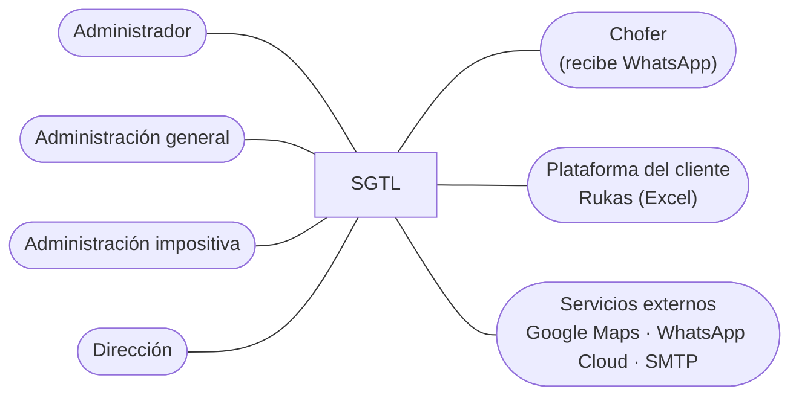

**Administrador.** Surge de la necesidad de controlar quién accede a cada parte del sistema. Da de
alta usuarios, arma los grupos con sus permisos sobre cada menú, asigna los permisos especiales de
facturación, configura las integraciones (correo, WhatsApp, facturación), personaliza el contenido
visual y consulta la auditoría. En SGTL es el usuario con rol `admin`, que ve todos los menús.

**Administración general.** Representa a la encargada administrativa general relevada en la V1.5.
Es quien hoy recibe las hojas de ruta, coordina con el cliente y carga los viajes en Rukas. En el
sistema registra camiones, choferes, clientes, orígenes, destinos y tarifas; registra los viajes y
sigue su estado; arma los presupuestos y las proformas, controla la proforma de la plataforma y
emite las facturas.

**Administración impositiva.** Representa a la encargada de cuentas bancarias y pagos. En el sistema
consulta la cuenta corriente de cada cliente, registra los recibos y los imputa, y emite notas de
crédito y débito según sus permisos.

**Dirección.** Representa al dueño de la empresa, que según la V1.5 toma las decisiones a partir de
los informes de ingresos y egresos. Consulta el tablero de inicio (viajes por mes, principales
clientes, costo por viaje), los listados y la auditoría, y aprueba los presupuestos.

**Chofer.** No usa el sistema directamente: recibe por WhatsApp la hoja de ruta de cada viaje
asignado (cliente, origen, destino, fecha y enlace a Google Maps). Su existencia se justifica porque
la comunicación con el chofer era informal y no quedaba registrada.

**Plataforma del cliente (Rukas).** Sistema externo del cliente Marfrig. No se conecta con SGTL: el
intercambio es el Excel de la proforma que se importa y los números de referencia (transporte SAP,
remito, N° de entrega) que se cargan en cada viaje.

**Servicios externos.** Google Maps (ruta y distancia), la API de WhatsApp Cloud de Meta (mensajes al
chofer) y un servidor de correo SMTP (envío de presupuestos, proformas y facturas).

> **[CONFIRMAR]** si los grupos reales del sistema coinciden con estos actores. Hoy hay cinco grupos
> (entre ellos Administradores y Listados); conviene nombrarlos igual que los actores.

---

## Arquitectura del sistema

### Descripción general

SGTL es una aplicación web con arquitectura cliente-servidor en tres capas:

- **Capa de presentación.** Páginas HTML estáticas (`gestion-*.html` para registrar y modificar,
  `listado-*.html` para consultar) con Bootstrap 5 y jQuery, que se ejecutan en el navegador. Un JS
  compartido (`assets/static/js/sgtl-ui.js`) concentra los avisos, confirmaciones, estados, fechas y
  montos del design system. Los PDF de presupuestos, proformas y facturas se generan en el navegador
  con jsPDF, y las exportaciones a Excel con SheetJS. El menú lateral se arma según los permisos del
  usuario.
- **Capa de lógica de negocio.** API REST en ASP.NET Web API 2 sobre .NET Framework 4.8, organizada en
  33 controladores (uno por entidad o proceso: Viajes, Proformas, ProformasPlataforma, Comprobantes,
  CuentaCorriente, Presupuestos, Usuarios, Grupos, Auditoría, etc.). Aplica las reglas del negocio:
  estados del viaje, cálculo del importe (presupuesto, tarifa fija o tarifa por km), control de la
  proforma de la plataforma, numeración de comprobantes, imputación de recibos. Los servicios de
  WhatsApp (`Services/WhatsApp`) y el lector del Excel de Rukas (`Plataformas/`) están separados de
  los controladores. Documenta sus endpoints con Swagger.
- **Capa de datos.** Base de datos relacional en **Azure SQL** (base `Transporte_Sanchez`). La API
  accede con Entity Framework 6 (modelo EDMX) para las entidades originales y con SQL directo para
  las tablas incorporadas después. Un contexto propio (`Sgtlauditcontext.cs`) registra la auditoría
  de cada alta, baja y modificación. Los cambios de esquema se versionan como scripts numerados e
  idempotentes en `database/<módulo>/`.

El usuario ingresa con usuario y contraseña; la API devuelve un **token JWT** con su usuario y rol,
que la pantalla conserva durante la sesión.

### Diagrama de despliegue

Ambiente objetivo de producción: la base y la aplicación quedan en Azure, y la empresa solo necesita
un navegador. Hoy, en desarrollo, la API corre en local con IIS Express y las páginas con Live Server
(ver la tabla).

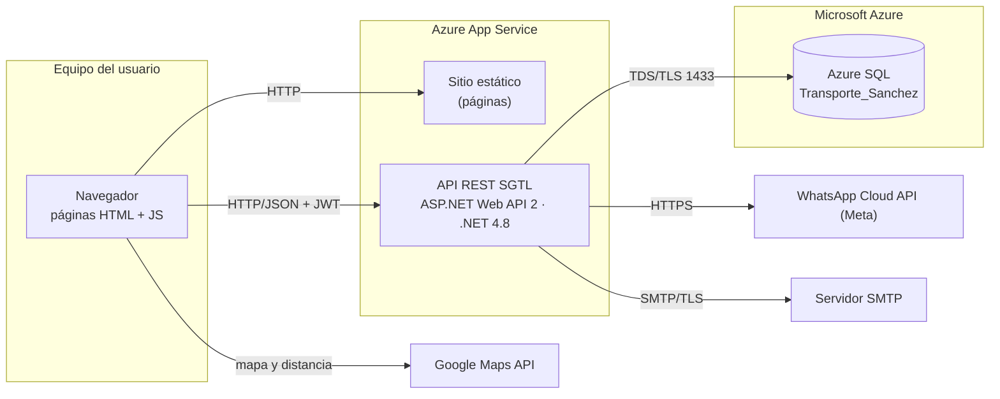

| Nodo / componente | Descripción |
|---|---|
| Equipo del usuario | PC o notebook con un navegador actualizado. La empresa ya tiene dos PC con Windows 10 Pro. |
| Sitio estático | Las páginas HTML, CSS y JS, publicadas en el mismo App Service. En desarrollo las sirve Live Server (puerto 5502). |
| API REST SGTL | Aplicación ASP.NET publicada en Azure App Service desde Visual Studio (Publicar). En desarrollo corre en IIS Express (`http://localhost:50222/api`). |
| Azure SQL | Base `Transporte_Sanchez` en el servidor `sql-tesis`, compartida por el equipo. Solo la API se conecta. |
| Google Maps API | Ruta y distancia de cada viaje; enlace al recorrido en la hoja de ruta. |
| WhatsApp Cloud API | Envío de la hoja de ruta al chofer con plantillas aprobadas por Meta. |
| Servidor SMTP | Envío de presupuestos, proformas y comprobantes por correo. |

**Ambiente de pruebas.** Cada cambio se escribe y se commitea en una Mac, y se compila y prueba en una
máquina virtual con Windows y Visual Studio, contra la misma base de Azure. Los resultados quedan en
un reporte de prueba por ronda.

### Ambiente de implementación

| Componente | Tecnología | Versión |
|---|---|---|
| Lenguajes | C# (API), JavaScript, HTML5 y CSS3 (pantallas), T-SQL | C# 7 · ES2015+ |
| Presentación | Bootstrap; jQuery; simple-datatables (grillas); ApexCharts (gráficos del inicio); jsPDF y jsPDF-AutoTable (PDF); SheetJS (Excel) | Bootstrap 5.1.3 · jQuery 3.6.0 · jsPDF 2.5.1 · AutoTable 3.8.2 |
| API | ASP.NET Web API 2 y MVC 5 sobre .NET Framework; Entity Framework; JWT (System.IdentityModel.Tokens.Jwt); Newtonsoft.Json; Swashbuckle (Swagger); MailKit (SMTP) | .NET 4.8 · Web API 5.2.7 · EF 6.2.0 · JWT 8.1.1 · Json 13.0.1 · Swashbuckle 5.6.0 · MailKit 2.11.1 |
| Base de datos | Azure SQL Database (motor SQL Server) | — |
| Servidor web | Azure App Service (producción) / IIS Express (desarrollo) | — |
| Integraciones | Google Maps JavaScript API; WhatsApp Cloud API (Meta Graph); SMTP | — |
| Control de versiones | Git y GitHub (`TransporteSanchez/SGTL`) | — |
| Herramientas | Visual Studio, Visual Studio Code con Live Server, SQL Server Management Studio, máquina virtual Windows | — |

### Diagramas de transición de estados

Se documentan las entidades que cambian de estado. Las transiciones que no elige el usuario las hace
el sistema al emitir o anular un comprobante.

#### Viaje (cliente directo)

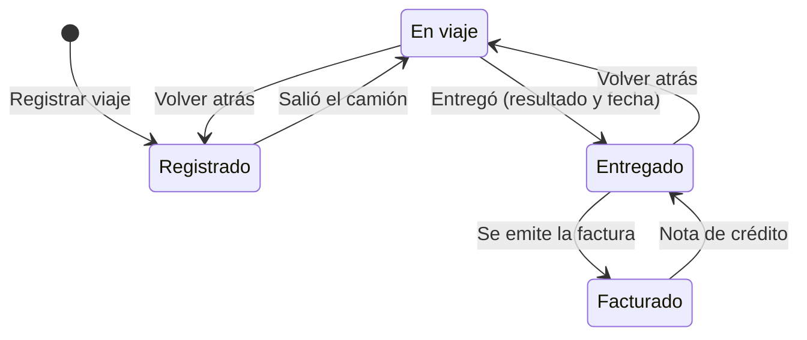

#### Viaje (cliente con plataforma)

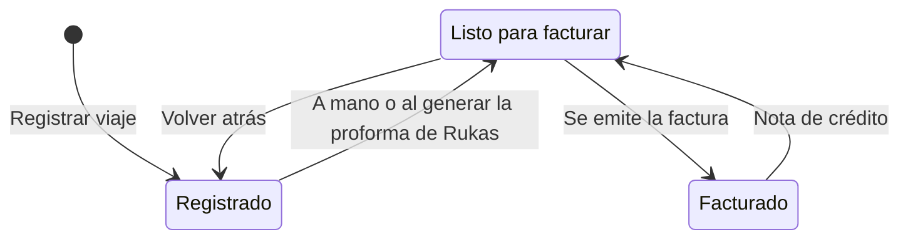

#### Presupuesto

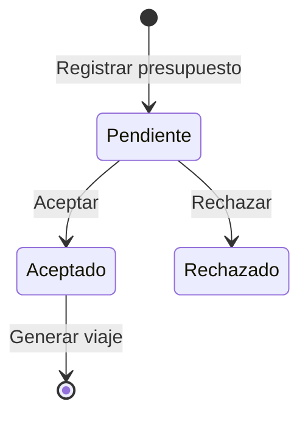

#### Proforma propia

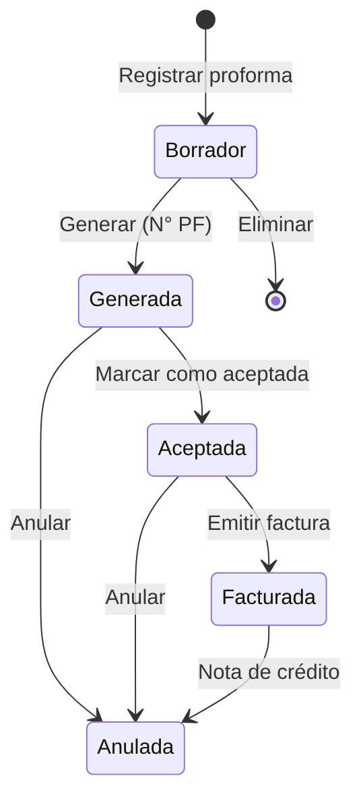

#### Proforma de plataforma (Rukas)

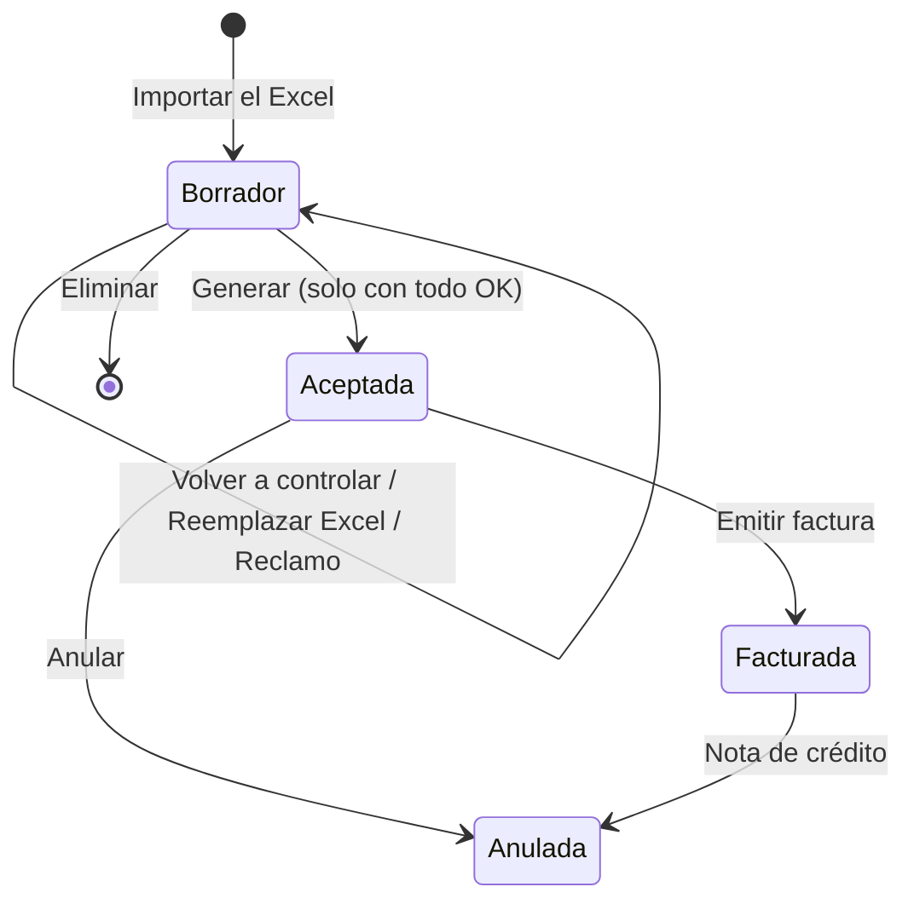

#### Comprobante (factura, nota de crédito, nota de débito, recibo)

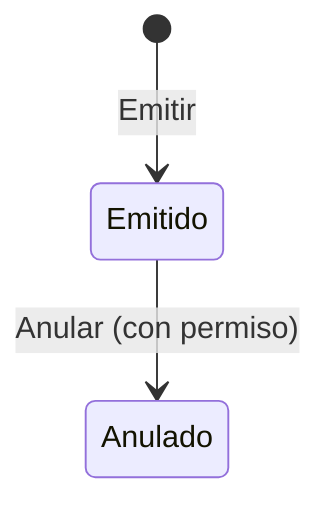

### Diagrama de secuencia — proforma de plataforma

Muestra el intercambio manual entre Transporte Sánchez, Rukas y SGTL.

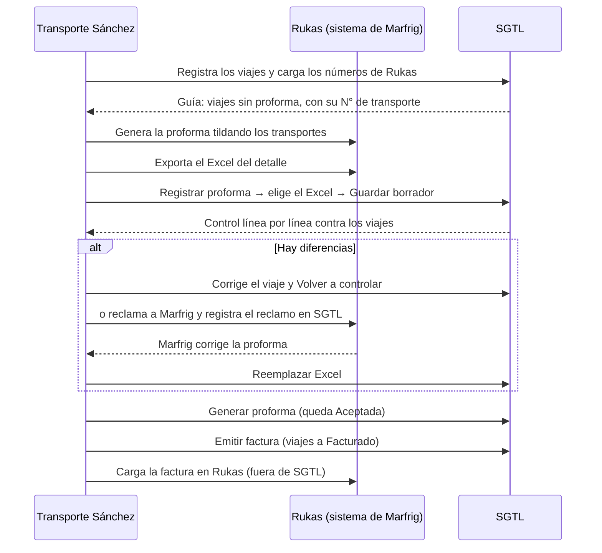

---

## Diagrama entidad-relación

Versión simplificada con las tablas principales y sus relaciones (sale de las asociaciones del modelo
EDMX y de las claves foráneas de los scripts de base de datos). La base tiene unas 45 tablas.

### Viajes y datos maestros

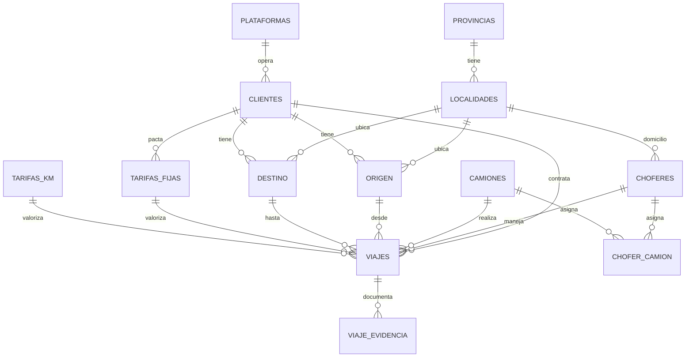

### Presupuestos, proformas y facturación

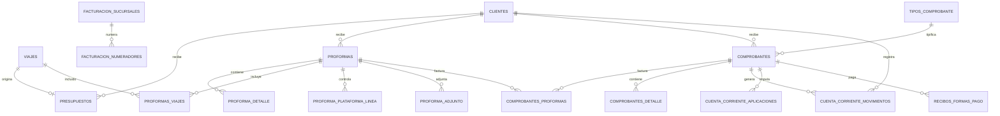

### Usuarios y permisos

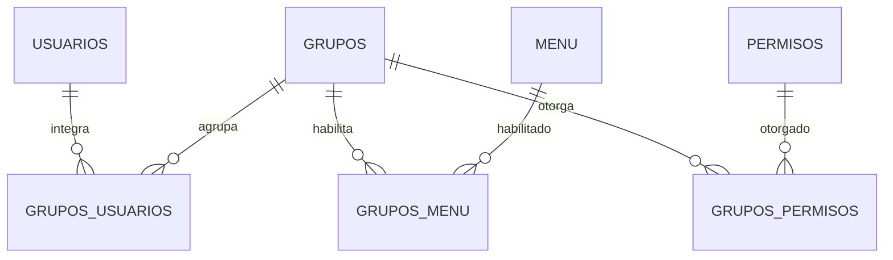

Tablas de soporte sin relaciones de negocio: `AUDITORIA`, `GESTION_CONTENIDO`, `MANUAL_USUARIO`,
`VERSIONES`, `EmailServidor`, `CONFIGURACION_EMAIL_MODULO`, `HISTORIAL_ENVIOS_COMPROBANTES`,
`WHATSAPP_CONFIG`, `FACTURACION_TIPOS_COMPROBANTE`.

> **[REVISAR]** las relaciones marcadas como deducidas (`PROFORMAS_VIAJES`, `COMPROBANTES_DETALLE`,
> `CUENTA_CORRIENTE_*`, `RECIBOS_FORMAS_PAGO`) contra el diagrama de SSMS.
